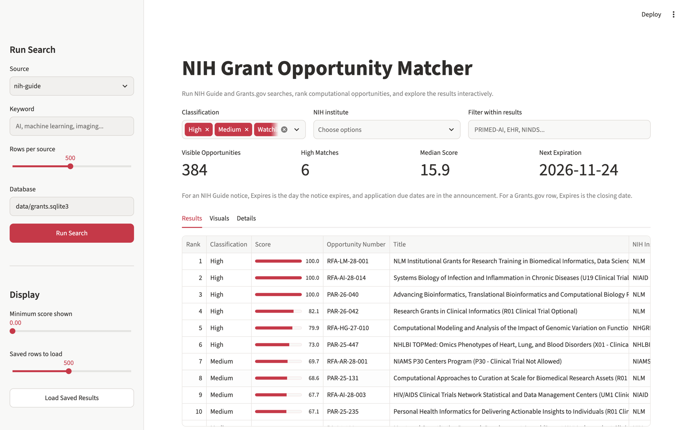

# Research Grant Finder Agent

### An agentic AI tool for searching, screening, and ranking NIH funding opportunities based on research interests and proposal relevance.

<p align="center">
  <b>Discover. Analyze. Rank. Review. Act.</b>
</p>

<p align="center">
  An agent-oriented research intelligence workflow that continuously transforms public NIH funding information into prioritized opportunities for AI, machine learning, data science, bioinformatics, imaging, and computational research teams.
</p>

<p align="center">
  
  
  
  
  
  
  
  
</p>

---

## From Grant Search to Grant Intelligence

Researchers often spend hours manually searching funding databases, reviewing long opportunity announcements, and deciding whether a funding opportunity aligns with their expertise.

The **Research Grant Finder Agent** explores a different approach.

Instead of treating funding discovery as a simple keyword search problem, this AI tool organizes the process as an **agent-oriented research workflow**.

It searches public funding sources, collects available opportunities, analyzes their content, and ranks them based on research and computational relevance. The goal is to help researchers quickly identify opportunities that may be worth exploring further.

The objective is simple:

> **Turn fragmented public funding information into actionable research intelligence.**

---

## Current Dashboard

<p align="center">
  
</p>

<p align="center">
  <i>Interactive dashboard for searching, screening, and ranking NIH funding opportunities.</i>
</p>

---

## Why This Tool?

Finding the right NIH funding opportunity is not always easy.

A researcher interested in data science, or computational health research may search for those exact terms. However, a relevant funding announcement may use different language, such as:

- Predictive modeling
- Clinical prediction
- Multimodal data
- Bioinformatics
- Omics
- Medical imaging
- Statistical modeling
- Data integration

A simple keyword search may miss these opportunities.

The **Research Grant Finder Agent** provides an intelligent first review of available funding opportunities. It searches official funding sources, screens opportunity descriptions, and ranks potentially relevant grants for researcher review.

The tool is designed to answer a simple question:

> **Which funding opportunities should I look at first?**

## How Does It Work?

The system separates major grant intelligence tasks into specialized AI agents.

| Agent                             | Responsibility                                                         |
| --------------------------------- | ---------------------------------------------------------------------- |
| **NIH Guide Ingestion Agent**  | Discovers and normalizes NIH Guide funding announcements               |
| **Grants.gov Ingestion Agent** | Searches and enriches federal opportunity records                      |
| **Grant Parser Agent**         | Converts heterogeneous funding records into a common opportunity model |
| **ML Relevance Agent**         | Evaluates relevance to the profile, computational in the built-in one |
| **NIH Context Agent**          | Retrieves related funded-project context from NIH RePORTER             |
| **Digest Agent**               | Produces prioritized funding intelligence reports                      |
| **Review Feedback Agent**      | Captures researcher feedback for future relevance tuning               |

These agents support a coordinated workflow for funding discovery and prioritization.

```text
                    ┌──────────────────────────┐
                    │   PUBLIC FUNDING DATA    │
                    └─────────────┬────────────┘
                                  │
             ┌────────────────────┼────────────────────┐
             │                    │                    │
             ▼                    ▼                    ▼
      ┌─────────────┐      ┌─────────────┐      ┌─────────────┐
      │ NIH GUIDE   │      │ GRANTS.GOV  │      │NIH RePORTER │
      └──────┬──────┘      └──────┬──────┘      └──────┬──────┘
             │                    │                    │
             ▼                    ▼                    ▼
      ┌─────────────┐      ┌─────────────┐      ┌─────────────┐
      │ NIH GUIDE   │      │ INGESTION   │      │ NIH CONTEXT │
      │    AGENT    │      │    AGENT    │      │    AGENT    │
      └──────┬──────┘      └──────┬──────┘      └─────────────┘
             │                    │
             └────────────┬───────┘
                          ▼
                  ┌───────────────┐
                  │ GRANT PARSER  │
                  │     AGENT     │
                  └───────┬───────┘
                          ▼
                  ┌───────────────┐
                  │ DEDUPLICATION │
                  │  & FILTERING  │
                  └───────┬───────┘
                          ▼
                  ┌───────────────┐
                  │ ML RELEVANCE  │
                  │     AGENT     │
                  └───────┬───────┘
                          ▼
             ┌────────────┼────────────┐
             │            │            │
             ▼            ▼            ▼
         🔴 HIGH       🟠 MEDIUM    🟡 WATCHLIST
             │            │            │
             └────────────┼────────────┘
                          ▼
                  ┌───────────────┐
                  │    SQLITE     │
                  │ INTELLIGENCE  │
                  │     STORE     │
                  └───────┬───────┘
                          ▼
          ┌───────────────┼────────────────┐
          │               │                │
          ▼               ▼                ▼
      DASHBOARD         EXCEL           DIGEST
                          │
                          ▼
                  RESEARCHER REVIEW
                          │
                          ▼
                  FEEDBACK AGENT
```

---

## How the Intelligence Engine Thinks?

The system does not rely on a single keyword.

Each funding opportunity is evaluated using multiple computational signals.

### 1. Computational Keyword Intelligence

With the built-in profile, the engine searches for signals associated with:

* Artificial intelligence
* Machine learning
* Deep learning
* Predictive modeling
* Data science
* Bioinformatics
* Omics
* Medical imaging
* Statistical modeling
* Multimodal data
* Data integration
* Informatics and biostatistics
* Data coordination, management, standards, and sharing
* Secondary data analysis

### 2. Title Centrality Analysis

Profile terms appearing directly in the opportunity title receive stronger relevance weighting.

The assumption is that a term appearing in the title is more likely to represent a central scientific theme.

### 3. Grant Similarity Analysis

Opportunity descriptions are compared with the example sentences of the profile, curated AI and data-science grant examples in the built-in one.

Each word is weighted by how rare it is in NIH Guide text, so a shared word such as "phenotypes" counts for far more than "health". The weights come from a table in the repository, built from 3,000 expired opportunities, so an opportunity gets the same score whatever else a run fetched. The match reason names the shared words.

Text similarity provides an additional relevance signal when explicit computational terminology is limited.

### 4. NIH/HHS Source Intelligence

The scoring system considers whether the opportunity originates from an NIH or HHS source.

A profile can name up to three NIH institutes. A record that one of them issued gets 8 more points, and its reasons say "Issued by NHLBI, an institute in your profile". A record issued by NIH for several institutes, or by the NIH Office of the Director, gets none. The built-in profile names no institute.

### 5. Expiration Awareness

An opportunity that expires in 15 to 240 days ranks a little higher than one that expires sooner or later. For an NIH Guide notice, the date shown is the day the notice expires, and application due dates are in the announcement. For a Grants.gov opportunity, it is the closing date.

### 6. Record Completeness

Opportunities with richer metadata receive additional consideration.

### 7. Biomedical Noise Reduction

Generic biomedical terminology can create false-positive computational matches.

The intelligence engine applies penalties when biomedical language is broad but computational evidence is weak.

---

## Opportunity Intelligence Classification

Each opportunity receives a relevance score from **0–100**.

| Intelligence Level | Interpretation                                                                                        |
| ------------------ | ----------------------------------------------------------------------------------------------------- |
| 🔴 **HIGH**        | Strong evidence that AI, ML, statistics, or computational expertise may be central to the opportunity |
| 🟠 **MEDIUM**      | Potential opportunity for interdisciplinary data-science collaboration                                |
| 🟡 **WATCHLIST**   | Weak or emerging computational signals; retained for monitoring                                       |

A score of 70 or more is High, 35 to 69 is Medium, and below 35 is Watchlist. Saved opportunities are scored again each time they are read, so the dashboard, the digest, and the Excel file use the current rules and today's date. A database that cannot be written to is shown with the scores it holds, with a warning.

The score is designed to **prioritize expert review—not replace scientific judgment**.

---

## Research Intelligence Dashboard

The Streamlit interface provides an interactive environment for grant opportunity analysis.

Researchers can:

* Search NIH Guide and Grants.gov
* Filter by relevance classification
* Filter by NIH institute
* Search within computational signals
* Review relevance score distributions
* Monitor upcoming expiration dates
* Inspect why an opportunity matched
* Open official NIH Guide and Grants.gov records
* Export selected opportunities to Excel

### Dashboard Intelligence Metrics

The dashboard automatically displays:

* **Visible Opportunities**
* **High-Priority Matches**
* **Median Relevance Score**
* **Next Expiration**

---

## Explainable Opportunity Matching

A major design principle of the system is **transparent prioritization**.

For each opportunity, this tool  preserves:

* Relevance score
* Priority classification
* Matched profile terms
* Reasons for the match
* NIH institute
* Opportunity status
* Open and expiration dates
* Funding category
* Opportunity description
* Official source links

Researchers can inspect **why an opportunity was prioritized** before deciding whether to pursue it.

---

## NIH RePORTER Research Context

The architecture includes an **NIH Context Agent** designed to retrieve related funded projects from NIH RePORTER.

This capability creates a foundation for future research intelligence tasks such as:

* Identifying previously funded work
* Exploring related scientific topics
* Understanding funding patterns
* Comparing new opportunities with funded projects
* Identifying potential research gaps

---

## Human-in-the-Loop Research Intelligence

The package includes a **Review Feedback Agent** that can record whether an opportunity was useful, with a review note, in the SQLite store.

The dashboard and the command-line tool do not call it yet, so feedback can be recorded only from Python code.

This creates the foundation for a future adaptive recommendation system in which researcher feedback can improve opportunity prioritization.

```text
Agent Recommendation
        │
        ▼
Researcher Review
        │
        ▼
Useful / Not Useful
        │
        ▼
Feedback Store
        │
        ▼
Future Relevance Tuning
```

The long-term objective is a **human-AI collaborative grant discovery environment**.

---

## Technology Stack

| Technology            | Role                                        |
| --------------------- | ------------------------------------------- |
|    Python             | Agent and workflow development              |
|    Pandas             | Data processing and analytics               |
|    Streamlit          | Interactive research intelligence interface |
|     SQLite            | Persistent opportunity intelligence store   |
|    REST APIs          | Funding and research data integration       |
|    Excel              | Research collaboration and export           |
|    Similarity Scoring | Computational relevance analysis            |

---

## Current Capabilities

The research prototype currently supports:

* Multi-source funding ingestion
* NIH Guide opportunity collection
* Grants.gov search and enrichment
* Heterogeneous grant record normalization
* Opportunity deduplication
* NIH/HHS opportunity filtering
* Computational relevance scoring
* Explainable match reasoning
* Expiration-aware prioritization
* SQLite persistence
* Saved opportunity retrieval
* Markdown digest generation
* Excel export
* Interactive Streamlit analytics
* NIH RePORTER research-context retrieval
* Researcher feedback storage (Python API only)

---

## Getting Started

### 1. Clone the Repository

```bash
git clone https://github.com/jrmatherly/Research-Grant-Finder-Agent.git
cd Research-Grant-Finder-Agent/"NIH Extractor"
```

### 2. Install uv

The project uses [uv](https://docs.astral.sh/uv/) to install Python and the dependencies. Follow the [uv installation guide](https://docs.astral.sh/uv/getting-started/installation/).

### 3. Install Dependencies

```bash
uv sync
```

This creates `.venv` with the versions pinned in `uv.lock`.

### 4. Launch the Research Intelligence Dashboard

```bash
uv run streamlit run streamlit_app.py
```

The dashboard will open in your browser. To learn the controls, see [Use the NIH Grant Matcher dashboard](docs/dashboard.md).

To start it with a double-click instead, use `launch_ui.command` on macOS, or `launch_ui.bat` on Windows (`launch_ui.vbs` hides the console window). The Windows scripts have not been tested. If macOS refuses to open `launch_ui.command`, which can happen after a ZIP download, right-click it and choose Open.

### Run with Docker

From the repository root, build the image and start the dashboard:

```bash
docker compose up --build -d
```

Open http://localhost:8501. The port is published on this machine only. The database, Excel files, and digests are written to `NIH Extractor/data`, `NIH Extractor/outputs`, and `NIH Extractor/digests`.

Run the command-line tool in the same image:

```bash
docker compose run --rm app python -m nih_grant_matcher run --source nih-guide
```

Stop the dashboard with `docker compose down`.

On Linux, create the output folders before the first start, so that Docker does not create them as root, and run the container as your own user:

```bash
mkdir -p "NIH Extractor"/{data,outputs,digests}
APP_UID=$(id -u) APP_GID=$(id -g) docker compose up --build -d
```

Without `APP_UID` and `APP_GID`, the container writes as user 1000. To keep the two values, write them in a file named `.env` beside `compose.yaml`. If the folders already hold results that another user owns, such as user 1000 from an earlier start, give them to yourself first:

```bash
sudo chown -R "$(id -u):$(id -g)" "NIH Extractor"/{data,outputs,digests}
```

CI publishes the image as `ghcr.io/jrmatherly/nih-grant-matcher`. To run it without a clone of this repository, or to update, pin, and troubleshoot it, see [Run NIH Grant Matcher from the published Docker image](docs/docker.md).

To run the dashboard in its own window as a macOS app, download the disk image from the [releases page](https://github.com/jrmatherly/Research-Grant-Finder-Agent/releases) or see [Build NIH Grant Matcher as a macOS app](docs/macos-app.md).

### Use the Command Line

Run these commands from `NIH Extractor/`. The package uses the standard library only, so plain `python` works too.

| Command | Result |
| --- | --- |
| `uv run python -m nih_grant_matcher run --source nih-guide` | Fetches, scores, and saves opportunities, then writes `digests/latest.md`. `--source` also accepts `grants.gov` and `both`. |
| `uv run python -m nih_grant_matcher digest` | Writes the digest again from the saved opportunities. |
| `uv run python -m nih_grant_matcher excel` | Writes the saved opportunities to `outputs/nih_grant_opportunities.xlsx`. |
| `uv run python -m nih_grant_matcher reporter-context --term "machine learning"` | Prints related funded projects from NIH RePORTER. |
| `uv run python -m nih_grant_matcher rarity-table` | Rebuilds the word-rarity table from expired NIH Guide opportunities. Scores computed after a rebuild change. |
| `uv run python -m nih_grant_matcher profile show` | Prints the saved profile, or the built-in one when none is saved. |
| `uv run python -m nih_grant_matcher profile export --out profile.json` | Writes that profile to a file. |
| `uv run python -m nih_grant_matcher profile import profile.json` | Saves the profile in the file, or refuses a file that is not a valid profile. |
| `uv run python -m nih_grant_matcher profile reset` | Deletes the saved profile, so ranking uses the built-in one. |
| `uv run python -m nih_grant_matcher apply start PAR-27-074 --type R03` | Starts an application for a saved opportunity and prints its number. Add `--resubmission` for a resubmission. |
| `uv run python -m nih_grant_matcher apply list` | Lists the applications. |
| `uv run python -m nih_grant_matcher apply fetch 1` | Fetches the full announcement of application 1. |
| `uv run python -m nih_grant_matcher apply requirements 1` | Prints the standing rules and what the announcement adds. |
| `uv run python -m nih_grant_matcher apply add 1 --kind aim --text "Map heart cells."` | Adds an input. `--file PATH` reads the text from a UTF-8 file. For `--kind reference`, add `--label smith2021`, and cite the reference in a section as `[@smith2021]`. |
| `uv run python -m nih_grant_matcher apply write 1 project-narrative --file narrative.txt` | Saves the text of a UTF-8 file as the newest revision of the section. |
| `uv run python -m nih_grant_matcher apply check 1` | Prints each section with its state and its findings. It exits with 1 while an error stands. |
| `uv run python -m nih_grant_matcher apply polish 1 specific-aims` | Asks the model you chose to polish the section and prints its proposal. `apply revise 1 specific-aims --instruction TEXT` asks for a revision. The section does not change. |
| `uv run python -m nih_grant_matcher apply accept 1 3` | Makes proposal 3 the newest revision of its section. `apply discard 1 3` sets it aside. |
| `uv run python -m nih_grant_matcher apply disclosure 1 --on` | Puts the AI-use statement in the export and prints it. `--off` leaves it out. |
| `uv run python -m nih_grant_matcher apply sign 1 project-narrative --signer "A. Applicant"` | Signs off the newest revision. |
| `uv run python -m nih_grant_matcher apply export 1 --out export` | Writes the section files, the requirements, the provenance log, and the AI-use statement while it is on, to the folder, and prints its full path. |
| `uv run python -m nih_grant_matcher apply delete 1 --yes` | Deletes the application and everything logged for it. Without `--yes`, nothing is deleted. |

Add `--help` to a command to see its options. Saved opportunities whose expiration date has passed are left out of the dashboard, the digest, and the Excel file.

### Set your profile

Ranking starts from a built-in profile for machine learning and data science. A researcher in another field sets a profile of their own. In the dashboard, select **Profile** in the sidebar, then **Set up my profile**. The wizard asks for your research aims, proposes terms from them, and previews how the saved opportunities would move before you save. The same view exports the profile to a JSON file and imports one. On the command line, `profile show`, `profile export --out PATH`, `profile import PATH`, and `profile reset` print, export, import, and reset the profile. See [Set your profile](docs/dashboard.md#set-your-profile).

### Write an application

Grant Matcher holds an NIH application while you write it, for the activity codes R01, R03, R15, R16, R21, R34, RF1, and U01. In the dashboard, open an opportunity under **Details** and select **Start application**. In the **Apply** view you fetch the full announcement. The view lists the standing limits and what the announcement adds for you to confirm, and keeps your aims, methods, and references as inputs. You write each section yourself. Each save that changes the text adds a revision to a log, and the checks flag a section over its limit, a missing heading, a citation to a reference you did not enter, and wording that marks text as written by a model. You sign off a section that has no error, and the export writes one Markdown file per section with the requirements and the provenance log. A model you choose can polish or revise a section. Its text enters the section only when you accept it, and an AI-use statement built from the log says what it did. On the command line, `apply start`, `apply fetch`, `apply write`, `apply polish`, `apply accept`, `apply check`, `apply sign`, and `apply export` do the same. See [Write an application](docs/dashboard.md#write-an-application).

---

## Research Software Status

> **Current Stage: Functional Research Prototype**

The system currently implements an agent-oriented funding discovery and prioritization workflow.

It is intended as a research software platform for exploring how data science, AI, and agent-based architectures can support research development and funding intelligence.

The current intelligence engine uses explainable computational scoring and text similarity.

It does **not currently rely on a Large Language Model for autonomous scientific reasoning**.

This distinction is intentional and provides a transparent baseline for evaluating future LLM-based agents.

---
## Long-Term Vision

The long-term vision is to evolve the Research Grant Finder Agent into an **Agentic Research Grant Finding Intelligence Platform**.

A future research team could provide:

* Research interests
* CVs or biosketches
* Publication histories
* Technical expertise
* Prior grant experience

Autonomous research agents could then:

1. Continuously monitor funding sources.
2. Detect newly published opportunities.
3. Analyze scientific and computational requirements.
4. Compare opportunities with researcher expertise.
5. Review related NIH-funded projects.
6. Explain why an opportunity may be relevant.
7. Identify expertise gaps.
8. Recommend potential collaborators.
9. Monitor deadlines and announcement changes.
10. Deliver personalized research funding intelligence.

> **The goal is not to replace researchers or research development professionals. The goal is to give them an intelligent research agent that continuously searches, analyzes, and prioritizes opportunities on their behalf.**

---

## Responsible Use and Disclaimer

This project is not affiliated with or endorsed by the National Institutes of Health, Grants.gov, or the U.S. Department of Health and Human Services.

The software uses publicly available official information to support funding opportunity discovery and prioritization.

Relevance scores and classifications are research-support signals only.

Always verify:

* Eligibility
* Deadlines
* Funding mechanism
* Application requirements
* Clinical or scientific scope
* Submission instructions

using the official funding opportunity announcement.

---

## Idea & Developed by

**Md. Saifur Rahman**

---

## License

This repository is a fork of [Quazi-07/Research-Grant-Finder-Agent](https://github.com/Quazi-07/Research-Grant-Finder-Agent) by Md. Saifur Rahman. The original work was published without a license, so it remains his and all rights to it are reserved.

The changes made in this fork are by Jason Matherly and are released under the [MIT License](LICENSE). The license does not cover the original work. To reuse the project as a whole, ask the original author for permission.

---

⭐ **If this research tool is useful to you, consider starring the repository.**

💡 **Ideas, issues, and research collaborations are welcome.**
