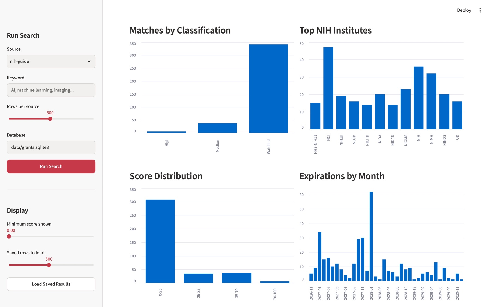

# Use the NIH Grant Matcher dashboard

The dashboard searches the NIH Guide and Grants.gov, scores each funding opportunity for AI and data-science relevance, and shows the ranked results. This guide explains each control and the common tasks.

To start the dashboard, see the [README](../README.md#getting-started) for a local start or [Run NIH Grant Matcher from the published Docker image](docker.md) for Docker. Then open http://localhost:8501.

## The layout

- **The sidebar** on the left starts with **View**, which switches between **Find** and **Profile**, and the **Database** path. In the Find view it holds three groups of controls: **Run Search**, **Display**, and **Export**.
- **The filter row** at the top of the page narrows the results that are already loaded.
- **The four metrics** summarize the rows that the filters leave visible.
- **The three tabs** show those rows as a table (**Results**), as charts (**Visuals**), and one at a time (**Details**).

When you open the dashboard and saved results exist, the dashboard loads them. You do not have to search first.

## Run a search

1. In the sidebar, under **Run Search**, choose a **Source**.
2. To search by topic, enter a **Keyword**. To see everything that is open, leave it empty.
3. Select **Run Search**.

A green message reports how many records the search fetched and how many it saved. An NIH Guide search takes a few seconds. A Grants.gov search makes one request for each row, so the default of 500 rows takes about three minutes.

| Control | What it does |
| --- | --- |
| **Source** | `nih-guide` searches the NIH Guide for Grants and Contracts. `grants.gov` searches Grants.gov for NIH opportunities. `both` searches the two and keeps one row for each opportunity number. When both sources hold the same number, the NIH Guide record is kept. |
| **Keyword** | The words are sent to the source's own search. With a keyword, the NIH Guide returns the best matches first. Without one, it returns the newest notices first. On 2026-11-22, an empty search returned 371 notices and "machine learning" returned 91. |
| **Rows per source** | The most rows to fetch from each source, from 25 to 1000. The default is 500. |
| **Database** | The file that holds the saved results. Leave the default, `data/grants.sqlite3`, unless you keep separate result sets. |

If a yellow message says that a source reached the row limit, the source holds more rows than you asked for. Raise **Rows per source** and search again.

A keyword changes which opportunities the search fetches. It does not change how an opportunity is scored.

After a search, the page shows the results of that search only. Results from earlier searches stay in the database. To see everything that is saved, select **Load Saved Results**.

## Read the score and the level

Each opportunity has a score from 0 to 100 and a level.

| Level | Score | Meaning |
| --- | --- | --- |
| High | 70 to 100 | AI, machine learning, statistics, or computation is probably central to the opportunity. |
| Medium | 35 to 69 | The opportunity has room for a data-science contribution. |
| Watchlist | Below 35 | The computational signal is weak. The row is kept so that you can watch it. |

The score comes from fixed rules and uses no language model. It rises when the title or the description names computational terms, when the text is close to example AI and data-science grants, and when the record is complete. The [README](../README.md#how-the-intelligence-engine-thinks) describes each part.

The score ranks opportunities for a first look. It does not judge scientific fit. Read the announcement before you decide.

## Narrow the results

Use the filter row at the top of the page and the **Display** group in the sidebar. A filter changes what you see. It does not search again and does not change the saved results.

| Control | What it does |
| --- | --- |
| **Classification** | Shows the levels that you keep selected. All three are selected at the start. |
| **NIH institute** | Shows the institutes that you select, such as NCI or NLM. With none selected, every institute shows. |
| **Filter within results** | Shows the rows whose title, matched terms, or summary contain the text. Capital letters do not matter. The filter does not search the opportunity number or the institute. |
| **Minimum score shown** | Hides rows below the score. It also applies to the Excel export. |
| **Saved rows to load** | The most rows that **Load Saved Results** reads, highest score first. The range is 50 to 1000. |

The four metrics follow the filters.

| Metric | Meaning |
| --- | --- |
| **Visible Opportunities** | The number of rows that the filters leave. |
| **High Matches** | The number of those rows at the High level. |
| **Median Score** | The middle score of those rows. |
| **Next Expiration** | The earliest date in the **Expires** column among those rows. |

## Read the dates

**Expires** does not mean the same thing for the two sources.

- For an NIH Guide notice, it is the day the notice expires. It is not an application due date. Most notices have several due dates, and the announcement lists them.
- For a Grants.gov row, it is the closing date.

An opportunity whose date has passed is left out of the dashboard, the digest, and the Excel file.

## Review the results

### Results tab

The table lists the visible rows, highest score first. Select a column heading to sort by that column. Scroll right for the remaining columns.

| Column | Contents |
| --- | --- |
| **Rank**, **Classification**, **Score** | The position in the loaded results, the level, and the score. |
| **Opportunity Number**, **Title** | The NIH number, such as `RFA-LM-28-001`, and the title. |
| **NIH Institute**, **Agency**, **Status** | The institute code, the agency name, and the status in the source. |
| **Open Date**, **Expires** | See "Read the dates". |
| **Activity**, **Category** | The activity codes, such as R01, and the notice type, such as RFA or PAR. |
| **Matched Terms**, **Why It Matched** | The computational terms found in the text, and the reasons for the score. |
| **Summary** | The purpose statement from the source. |
| **NIH Guide URL**, **Grants.gov URL** | Links to the official records. |

### Visuals tab

| Chart | Shows |
| --- | --- |
| **Matches by Classification** | The number of visible rows at each level. |
| **Top NIH Institutes** | The 12 institutes with the most visible rows. |
| **Score Distribution** | The number of rows in four score ranges: 0-25, 25-35, 35-70, and 70-100. A score on an edge counts in the higher range, so 35 is in 35-70. |
| **Expirations by Month** | The number of rows that expire in each month. |

### Details tab

1. Select the **Details** tab.
2. Under **Opportunity**, choose a row. The list holds the visible rows, so narrow the results first to shorten it.

The tab shows the score, the level, the institute, the date, the matched terms, the reasons for the score, and the summary. **Open NIH Guide** and **Open Grants.gov** open the official records.

## Export to Excel

1. Narrow the results to the rows that you want.
2. In the sidebar, under **Export**, select **Export Current View**.
3. Select **Download Excel**, which appears at the bottom of the page.

The export holds the visible rows. It also writes the file to the path in **Excel output**, which is `outputs/nih_grant_opportunities_ui.xlsx` at the start. With Docker Compose, that folder is `NIH Extractor/outputs` in the repository.

## Come back later

The database keeps every opportunity that a search saved. Each time the dashboard reads the database, it scores the saved rows again with the current rules and today's date, and it leaves out the rows that have expired.

To refresh the list, select **Run Search** with an empty keyword. The NIH Guide publishes new notices through the week, so search again whenever you want the current list.

## Set your profile

Ranking starts from a built-in profile for machine learning and data science. While it is in use, a line under the page title says so. To rank for your own field, select **Profile** under **View**, then select **Set up my profile**. The wizard has five steps. Select **Next** and **Back** to move between them.

1. **You.** Your name, institution, and career stage.
2. **Your research.** A summary, then three to six sentences, one per line, that state the aims of recent or planned work. Ranking compares each opportunity with these sentences.
3. **Your terms.** Terms proposed from the text of step 2, each with a weight from 1 to 30. Keep, remove, re-weight, or add terms. A term is saved in lower case.
4. **Preview.** The saved opportunities scored with your draft beside the current profile. The table shows the ten largest rises and the ten largest falls, each with its reasons. Nothing is saved yet.
5. **What the writer reuses.** Your expertise, your resources, and your prior work, one reference per row with a key, a citation, and a PMID or DOI. A key holds only letters, digits, and hyphens.

Select **Save profile** to keep the draft. It saves each step as of your last **Back**, **Next**, or **Finish**. The Find view then scores the saved opportunities again with your profile.

| Control | What it does |
| --- | --- |
| **Export profile** | Downloads the saved profile as a JSON file. The file holds your name and your example sentences. It holds no API key. |
| **Import a profile** | Paste the contents of an exported file. A line names the investigator and the number of terms, or a red message says what is wrong. Select **Import profile** to save it. |
| **Reset to built-in** | Removes your profile, so ranking uses the built-in profile again. |

## Use the command line

The same search and exports run without the dashboard. Run the commands from `NIH Extractor/`. With Docker Compose, put `docker compose exec app` in place of `uv run` and run from the repository root.

| Command | Result |
| --- | --- |
| `uv run python -m nih_grant_matcher run` | Searches the NIH Guide, saves the results, and writes `digests/latest.md`. |
| `uv run python -m nih_grant_matcher run --source both --keyword "imaging" --limit 200` | Searches both sources for a keyword, with at most 200 rows from each. |
| `uv run python -m nih_grant_matcher digest --min-score 35` | Writes the digest again from the saved results, Medium and High only. |
| `uv run python -m nih_grant_matcher excel --min-score 35` | Writes the saved results to `outputs/nih_grant_opportunities.xlsx`. |
| `uv run python -m nih_grant_matcher reporter-context --term "machine learning"` | Prints related funded projects from NIH RePORTER. |
| `uv run python -m nih_grant_matcher profile show` | Prints the profile that ranking uses. |
| `uv run python -m nih_grant_matcher profile export --out profile.json` | Writes that profile to a file. |
| `uv run python -m nih_grant_matcher profile import profile.json` | Saves the profile in the file. A file that is not a valid profile is refused with a message, and nothing is saved. |
| `uv run python -m nih_grant_matcher profile reset` | Goes back to the built-in profile. |

Add `--help` to a command to see its options. To use another database, put `--db <path>` before the command name.

## Troubleshooting

| Symptom | Cause | Fix |
| --- | --- | --- |
| "Run a search or load saved results to populate the dashboard." | The database is empty or is not at the **Database** path. | Select **Run Search**. |
| A red "Search failed" message with a web address | The named service did not answer, or it sent a reply that the tool cannot read. | Check the internet connection and search again. |
| A message that names `SSL_CERT_FILE` | A proxy on your network inspects secure connections, and Python does not trust its certificate. | Ask your IT staff for the proxy's certificate file, and set `SSL_CERT_FILE` to its path. |
| A yellow message that a source reached the row limit | The source holds more rows than **Rows per source**. | Raise **Rows per source** and search again. |
| A yellow message that the scores are "shown as last saved" | The database file cannot be written to. | Check the permissions of the `data` folder. In Docker on Linux, see "Where the results are saved" in the [Docker guide](docker.md). |
| A relevant opportunity has a low score | The text names none of the computational terms that the scoring looks for. | Lower **Minimum score shown**, or use **Filter within results** with your own term. |
