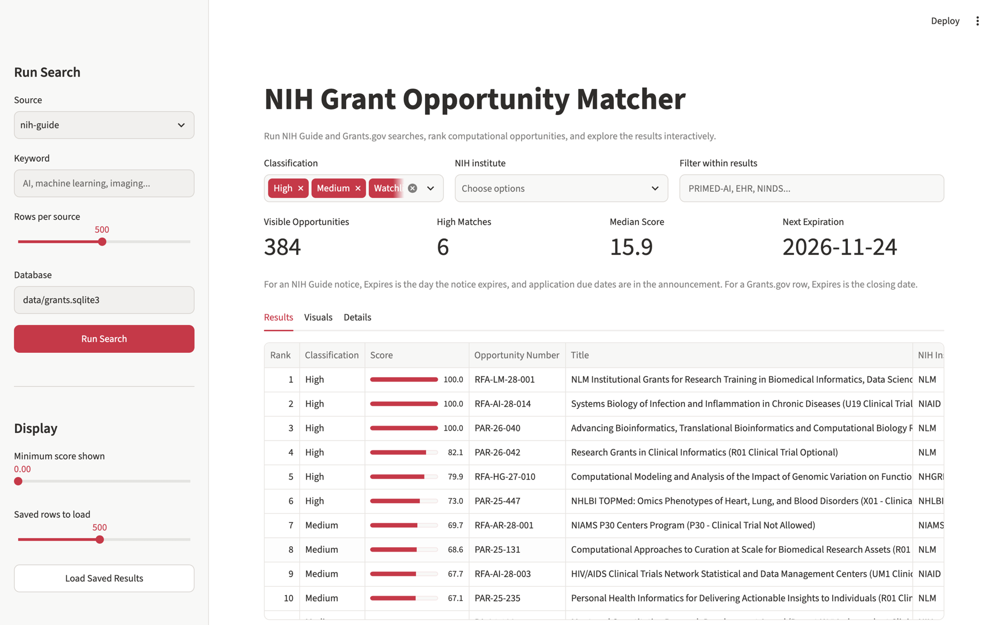
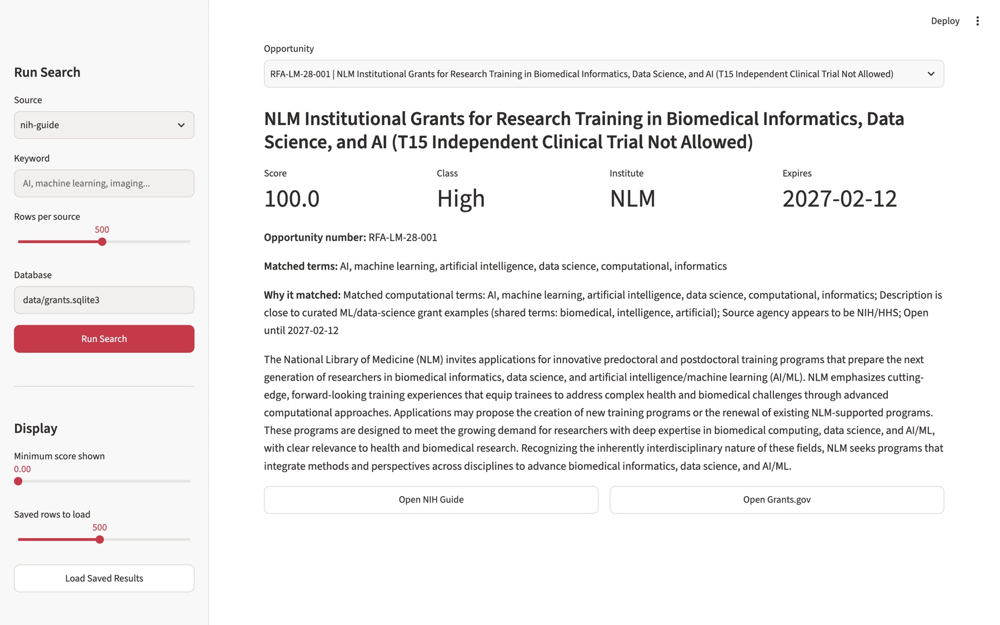

# Use the NIH Grant Matcher dashboard

The dashboard searches the NIH Guide and Grants.gov, scores each funding opportunity for AI and data-science relevance, or for your own profile, and shows the ranked results. This guide explains each control and the common tasks.

To start the dashboard, see the [README](../README.md#getting-started) for a local start or [Run NIH Grant Matcher from the published Docker image](docker.md) for Docker. Then open http://localhost:8501.

## The layout

- **The sidebar** on the left starts with **View**, which switches between **Find**, **Apply**, and **Profile**, and the **Database** path. In the Find view it holds three groups of controls: **Run Search**, **Display**, and **Export**.
- **The filter row** at the top of the page narrows the results that are already loaded.
- **The four metrics** summarize the rows that the filters leave visible.
- **The three tabs** show those rows as a table (**Results**), as charts (**Visuals**), and one at a time (**Details**).

When you open the dashboard and saved results exist, the dashboard loads them. You do not have to search first.

## Run a search

1. In the sidebar, under **Run Search**, choose a **Source**.
2. To search by topic, enter a **Keyword**. To see everything that is open, leave it empty.
3. Select **Run Search**.

A green message reports how many records the search fetched and how many it saved. An NIH Guide search takes a few seconds. A Grants.gov search makes one request for each row, so the default of 500 rows takes about three minutes.

| Control | What it does |
| --- | --- |
| **Source** | `nih-guide` searches the NIH Guide for Grants and Contracts. `grants.gov` searches Grants.gov for NIH opportunities. `both` searches the two and keeps one row for each opportunity number. When both sources hold the same number, the NIH Guide record is kept. |
| **Keyword** | The words are sent to the source's own search. With a keyword, the NIH Guide returns the best matches first. Without one, it returns the newest notices first. On 2026-11-22, an empty search returned 371 notices and "machine learning" returned 91. |
| **Rows per source** | The most rows to fetch from each source, from 25 to 1000. The default is 500. |
| **Database** | The file that holds the saved results. Leave the default, `data/grants.sqlite3`, unless you keep separate result sets. |

If a yellow message says that a source reached the row limit, the source holds more rows than you asked for. Raise **Rows per source** and search again.

A keyword changes which opportunities the search fetches. It does not change how an opportunity is scored.

After a search, the page shows the results of that search only. Results from earlier searches stay in the database. To see everything that is saved, select **Load Saved Results**.

## Read the score and the level

Each opportunity has a score from 0 to 100 and a level. The meanings below are those of the built-in profile.

| Level | Score | Meaning |
| --- | --- | --- |
| High | 70 to 100 | AI, machine learning, statistics, or computation is probably central to the opportunity. |
| Medium | 35 to 69 | The opportunity has room for a data-science contribution. |
| Watchlist | Below 35 | The computational signal is weak. The row is kept so that you can watch it. |

The score comes from fixed rules and uses no language model. It rises when the title or the description names terms of the profile, when the text is close to its example sentences, when the record is complete, and by 8 points when one of the NIH institutes in your profile issued the record. The [README](../README.md#how-the-intelligence-engine-thinks) describes each part.

The score ranks opportunities for a first look. It does not judge scientific fit. Read the announcement before you decide.

## Narrow the results

Use the filter row at the top of the page and the **Display** group in the sidebar. A filter changes what you see. It does not search again and does not change the saved results.

| Control | What it does |
| --- | --- |
| **Classification** | Shows the levels that you keep selected. All three are selected at the start. |
| **NIH institute** | Shows the institutes that you select, such as NCI or NLM. With none selected, every institute shows. |
| **Filter within results** | Shows the rows whose title, matched terms, or summary contain the text. Capital letters do not matter. The filter does not search the opportunity number or the institute. |
| **Minimum score shown** | Hides rows below the score. It also applies to the Excel export. |
| **Saved rows to load** | The most rows that **Load Saved Results** reads, highest score first. The range is 50 to 1000. |

The four metrics follow the filters.

| Metric | Meaning |
| --- | --- |
| **Visible Opportunities** | The number of rows that the filters leave. |
| **High Matches** | The number of those rows at the High level. |
| **Median Score** | The middle score of those rows. |
| **Next Expiration** | The earliest date in the **Expires** column among those rows. |

## Read the dates

**Expires** does not mean the same thing for the two sources.

- For an NIH Guide notice, it is the day the notice expires. It is not an application due date. Most notices have several due dates, and the announcement lists them.
- For a Grants.gov row, it is the closing date.

An opportunity whose date has passed is left out of the dashboard, the digest, and the Excel file.

## Review the results

### Results tab

The table lists the visible rows, highest score first. Select a column heading to sort by that column. Scroll right for the remaining columns.

| Column | Contents |
| --- | --- |
| **Rank**, **Classification**, **Score** | The position in the loaded results, the level, and the score. |
| **Opportunity Number**, **Title** | The NIH number, such as `RFA-LM-28-001`, and the title. |
| **NIH Institute**, **Agency**, **Status** | The institute code, the agency name, and the status in the source. |
| **Open Date**, **Expires** | See "Read the dates". |
| **Activity**, **Category** | The activity codes, such as R01, and the notice type, such as RFA or PAR. |
| **Matched Terms**, **Why It Matched** | The profile terms found in the text, and the reasons for the score. |
| **Summary** | The purpose statement from the source. |
| **NIH Guide URL**, **Grants.gov URL** | Links to the official records. |

### Visuals tab

| Chart | Shows |
| --- | --- |
| **Matches by Classification** | The number of visible rows at each level. |
| **Top NIH Institutes** | The 12 institutes with the most visible rows. |
| **Score Distribution** | The number of rows in four score ranges: 0-25, 25-35, 35-70, and 70-100. A score on an edge counts in the higher range, so 35 is in 35-70. |
| **Expirations by Month** | The number of rows that expire in each month. |

### Details tab

1. Select the **Details** tab.
2. Under **Opportunity**, choose a row. The list holds the visible rows, so narrow the results first to shorten it.

The tab shows the score, the level, the institute, the date, the matched terms, the reasons for the score, and the summary. **Open NIH Guide** and **Open Grants.gov** open the official records.

## Export to Excel

1. Narrow the results to the rows that you want.
2. In the sidebar, under **Export**, select **Export Current View**.
3. Select **Download Excel**, which appears at the bottom of the page.

The export holds the visible rows. It also writes the file to the path in **Excel output**, which is `outputs/nih_grant_opportunities_ui.xlsx` at the start. With Docker Compose, that folder is `NIH Extractor/outputs` in the repository.

## Come back later

The database keeps every opportunity that a search saved. Each time the dashboard reads the database, it scores the saved rows again with the current rules, the current profile, and today's date, and it leaves out the rows that have expired.

To refresh the list, select **Run Search** with an empty keyword. The NIH Guide publishes new notices through the week, so search again whenever you want the current list.

## Set your profile

Ranking starts from a built-in profile for machine learning and data science. A line under the page title names the profile that ranks. To rank for your own field, select **Profile** under **View**, then select **Set up my profile**. Once a profile is saved, the button reads **Edit my profile**. The wizard has five steps. Select **Next** and **Back** to move between them.

1. **You.** Choose **Rank with my own research** or **Keep the built-in ranking**, then your name, institution, and career stage. **Keep the built-in ranking** keeps the built-in terms and sentences and skips steps 2 to 4, so you can add your name and background and every score stays as it was. A line under the page title then says that ranking uses the built-in profile, for you.
2. **Your research.** A summary, then three to six sentences, as a paragraph or one per line, that state the aims of recent or planned work. Ranking compares each opportunity with these sentences.
3. **Your terms.** Terms proposed from the text of step 2, each with a weight from 1 to 30. Keep, remove, re-weight, or add terms. A term is saved in lower case. Words that say what a study does, such as "test", "whether" and "how", are not proposed. Below the table, choose up to three under **Your NIH institutes**. A record issued by one of them gets 8 points, and its reasons say so. A record issued by NIH for several institutes gets no bonus.
4. **Preview.** The saved opportunities scored with your draft beside the current profile. The table shows the ten largest rises and the ten largest falls, each with its reasons. Nothing is saved yet.
5. **What the writer reuses.** Your expertise, your resources, and your prior work, one reference per row with a key, a citation, and an optional PMID and DOI. A key holds only letters, digits, and hyphens.

Select **Save profile** on any step to keep the draft, the step on screen included. A profile needs the example sentences of step 2 and the terms of step 3, and a red message names a step that is still missing. The Find view then scores the saved opportunities again with your profile.

| Control | What it does |
| --- | --- |
| **Export profile** | Downloads the profile in use as a JSON file, the built-in one when none is saved. The file holds everything you entered, including your name, institution, research text, and references. It holds no API key. |
| **Import a profile** | Paste the contents of an exported file. A line names the investigator and the number of terms, or a red message says what is wrong. Select **Import profile** to save it. |
| **Reset to built-in** | Removes your profile, so ranking uses the built-in profile again. When a saved profile cannot be read, a red message says so, ranking uses the built-in profile, and **Export profile** is turned off. This button then deletes the saved profile, and the database file holds its only copy. |

## Write an application

Grant Matcher holds an application for an NIH opportunity while you write it. It shows the full announcement, the limits and the parts that each section needs, and it checks the text you save. A model you choose can read the announcement's requirements for you to confirm, draft a section from your inputs, and polish or revise a section. Its text enters the section only when you accept it, and the log records which words came from it.

It writes applications for the activity codes R01, R03, R15, R16, R21, R34, RF1, and U01. It does not write a phased award such as an R21/R33, or a notice from FDA or NIOSH, which review by their own criteria.

1. **Start the application.** In the Find view, select the **Details** tab and choose an opportunity. Under the two link buttons, choose the **Grant type**, select **This is a resubmission** if it is one, and select **Start application**. The dashboard opens the **Apply** view on the new application. Starting the same opportunity again with the same grant type and the same resubmission choice opens the application you already have. When the opportunity lists no activity code that Grant Matcher writes, the button is turned off and a line names the codes. For a phased award, or a notice from FDA or NIOSH, the line also says why.
2. **Read the announcement.** Under **Announcement**, select **Fetch the full announcement**. Sections I, IV, and V of the announcement each get a panel that you open. Grant Matcher takes the text from Grants.gov, NIH's official source since fiscal 2026, and from the notice's page in the NIH Guide when Grants.gov only links to the announcement or does not answer. When that page cannot be read either, as for a notice from fiscal 2026 on, which has none, Grant Matcher saves the text of the NIH Guide's search service. That text drops some brackets and spaces and joins a heading to the next word, and a line under the source says so. Fetch again to get a revised announcement. A copy saved from Grants.gov is not replaced by the NIH Guide's text, which can be older. A decision you made is kept while the new text still has its sentence and Grant Matcher reads the same requirement from it. The message names each decision that was dropped, in this application and in any other application for the same announcement. When Grants.gov does not answer and the NIH Guide's text is saved, the message says that the text may not be the official one. When the announcement cannot be fetched, a red message says so, and the standing rules of the grant type still apply. When the text has no Section IV, a line says that Grant Matcher read no requirement from it, and the standing rules apply. The line goes once a model has read a requirement from Section I or V.
3. **Decide the requirements.** Under **Requirements**, the standing rules give each section's limit, with the NIH pages they come from. Below them, each requirement that Grant Matcher found in the announcement shows the text it comes from. Select **Confirm** or **Reject**. A page limit that you confirm replaces the standing one only for a section whose standing limit is in pages. For the Project Summary and the Project Narrative, a notice says that Grant Matcher does not apply it. Once a model is chosen, **Ask the model to read the announcement** sends Sections I, IV, and V to it, one at a time, and lists what each asks for, marked as read by a model. Grant Matcher keeps an item only when its quote is in the announcement and holds at least 20 letters and digits, so that a word or two cannot pass. It keeps a limit only when it names a section and its number stands as a number of its own in its quote and in the announcement, and the row shows that limit. The green line says how many items it dropped, if any. When one of the section calls fails, or its reply holds no list of requirements, nothing from that read is saved, and the calls already made are in the log. A quote shows where a sentence came from, not that it is a requirement, so confirm or reject each one. Asking again replaces the items you have not decided and keeps the ones you have, and an item read again with the same kind, section and quote as one you decided on is not added a second time. A fetch keeps a model's item while its sentence is in the new text.
4. **Enter your inputs.** Under **Your inputs**, add your aims, hypotheses, preliminary data, methods, and the rest, one at a time. Give a reference a key and cite it in a section as `[@key]`. The prior work of your profile is already there as references. A reference that you add gives its PMID or DOI in its text, as `PMID: 33611339` or `10.1038/s41586-021-03819-2`. A model can invent a reference, so **Check that each reference exists** sends the PMID of each reference to NCBI (PubMed), or its DOI to Crossref when it has no PMID. The request carries that identifier and the tool's name, and none of your text, and no model is involved. A line under each reference then gives the date of the check and the title that the index holds, for you to compare with what you typed, or says that the index has no record of it. Crossref holds only the DOIs that its members register, so a DOI registered elsewhere, such as an arXiv or Zenodo DOI, which DataCite registers, has no record there although the work exists. A reference with neither a PMID nor a DOI is not checked. When an index does not answer for a reference, the check goes on to the next one and records nothing for it. A red message then names each reference it could not check and says how many it checked. After two lookups in a row that get no answer it stops, because the index or the connection is most likely down. A reply that Grant Matcher cannot read, or a 404 that is not Crossref's own answer, counts as a failure for that reference and does not stop the check. Try again later, and for a reference that fails every time, correct its identifier or retire it. A line names the inputs that each section still needs. **Retire** takes an input out of the checks and keeps it in the record.
5. **Write each section.** Under **Sections**, choose a section, write in the box, and select **Save**. Each save that changes the text adds a revision. The checks run on the saved revision and list the errors first, then the warnings. A line gives the share of the words that you wrote. To have a model draft, polish or revise the section, see [Draft, polish and revise with a model](#draft-polish-and-revise-with-a-model).
6. **Sign off.** Keep the name from your profile or type yours, and select **Sign off**. A section with an error, or with no text, cannot be signed off. The sign-off records a statement that the section states your own ideas, with the revision and a hash of its text. A later save makes the section a draft again. So does an error that appears after the sign-off, such as a citation to a reference you retired. A yellow line then says why, and the sign-off stays in the log.
7. **Export.** Under **Log and export**, select **Export**. Grant Matcher writes one Markdown file for each section, `requirements.md`, and `provenance-log.md` to the **Export folder**, and `ai-use-statement.md` while the AI-use statement is on. The provenance log lists the revisions, the announcement, the inputs with the result of the reference check beside each reference, the model's reviews with their scores, and the sign-offs. The file of a section that is not signed off starts with `DRAFT-`. A green line gives the full path of the folder.

The checks look for a section over its limit, a missing Significance, Innovation, or Approach heading in the Research Strategy, a figure where the section takes none, a citation that names no reference you entered, a cited reference that PubMed or Crossref has not found, a link, the first person in the Project Summary, and wording that marks text as written by a model. A reference that was not checked, has no PMID or DOI, or that the index has no record of is a warning and does not block a sign-off. A page or line count is an estimate at NIH's densest allowed format, so the final PDF decides. The Project Narrative counts sentences, and a fourth sentence is an error. When an initial or a single letter, a closing quote, or a sentence that starts in lower case leaves the count in doubt, a warning gives both counts. Count the sentences by hand.

Each revision stays in the log. **Restore** on an earlier revision saves its text again as the newest. When the section was saved somewhere else after you opened it, **Save** keeps your text in the box, shows the newest revision beside it, and saves nothing. Copy what you need and select **Load the newest revision**.

From the sixth application that Grant Matcher starts in a calendar year, a yellow line says that NIH accepts six per investigator in a calendar year (NOT-OD-25-132). Grant Matcher counts only the applications it started.

Your text and your inputs are stored in the database file that the line under **Application** names. Anyone who can read that file can read them. To delete an application, type its opportunity number under **Delete this application** and select the button. The text, the inputs, the sign-offs, and the log go with it, and the delete cannot be undone. Files you exported stay where you exported them.

Grant Matcher does not submit an application or fill in the application forms. Read the announcement in full, because it can set rules that Grant Matcher does not find.

The same steps run on the command line, from `NIH Extractor/`. Confirm or reject a requirement in the dashboard.

| Command | Result |
| --- | --- |
| `uv run python -m nih_grant_matcher apply start PAR-27-074 --type R03` | Starts an application for a saved opportunity and prints its number. Add `--resubmission` for a resubmission, which adds the Introduction. |
| `uv run python -m nih_grant_matcher apply list` | Lists the applications. |
| `uv run python -m nih_grant_matcher apply fetch 1` | Fetches the full announcement of application 1. |
| `uv run python -m nih_grant_matcher apply requirements 1` | Prints the standing rules and what the announcement adds. |
| `uv run python -m nih_grant_matcher apply extract 1` | Sends Sections I, IV, and V of the fetched announcement to the model you chose and prints the requirements it read, with the number it dropped. |
| `uv run python -m nih_grant_matcher apply add 1 --kind reference --label smith2021 --text "Smith J. Heart cells. 2021."` | Adds an input. `--file PATH` reads the text from a UTF-8 file. |
| `uv run python -m nih_grant_matcher apply write 1 project-narrative --file narrative.txt` | Saves the text of a UTF-8 file as the newest revision of the section. |
| `uv run python -m nih_grant_matcher apply check 1` | Prints each section with its state and its findings. It exits with 1 while an error stands. |
| `uv run python -m nih_grant_matcher apply verify 1` | Sends the PMID of each reference to NCBI (PubMed), or its DOI to Crossref when it has no PMID, with the tool's name and none of your text. Prints, for each reference, the title that the index holds or that it has no record. When a lookup fails it prints what it saved for each reference, then the error. |
| `uv run python -m nih_grant_matcher apply polish 1 specific-aims` | Sends the newest revision of the section to the model you chose and prints its proposal, with the number of the proposal and its findings. The section does not change. |
| `uv run python -m nih_grant_matcher apply revise 1 specific-aims --instruction "Make the second aim shorter."` | The same, for a revision that follows your instruction. |
| `uv run python -m nih_grant_matcher apply draft 1 specific-aims` | Sends your inputs for the section, the requirements you confirmed for it, and the research summary and expertise in your profile to the model you chose, and prints its proposal in the same way. It does not send the section's text. It is refused while the section lacks an input it needs. |
| `uv run python -m nih_grant_matcher apply review 1 specific-aims` | Sends only the newest revision of the section and the review criteria you confirmed to the model you chose, and prints its estimate for each review factor and each point with the sentence it quotes. The section does not change. |
| `uv run python -m nih_grant_matcher apply accept 1 3` | Makes proposal 3 the newest revision of its section. A proposal made from an older revision is refused. Ask again. |
| `uv run python -m nih_grant_matcher apply discard 1 3` | Sets proposal 3 aside. It stays in the log, and the AI-use statement counts it. |
| `uv run python -m nih_grant_matcher apply disclosure 1 --on` | Puts the AI-use statement in the export and prints it. `--off` leaves it out. |
| `uv run python -m nih_grant_matcher apply sign 1 project-narrative --signer "A. Applicant"` | Signs off the newest revision. |
| `uv run python -m nih_grant_matcher apply export 1 --out export` | Writes the section files, the requirements, the provenance log, and `ai-use-statement.md` while the AI-use statement is on, to the folder, and prints its full path. |
| `uv run python -m nih_grant_matcher apply delete 1 --yes` | Deletes the application and everything logged for it. Without `--yes`, nothing is deleted. |

### Choose a model

The **Model** section at the top of the Apply view sets the model that will help you write. Choose a provider: Claude, OpenAI, Gemini, or a server that speaks the OpenAI API, such as Ollama, with its **Base URL**. Paste the provider's API key and select **Save key**. A line then says where the key is and, for a key of 12 characters or more, its last four characters. It never shows the key. On a Mac the key goes to the login Keychain. Elsewhere it goes to `llm-keys.json` beside the database, which only your account can read. On Windows that file's mode has no effect, and the file is protected by your user account only. A key in `ANTHROPIC_API_KEY`, `OPENAI_API_KEY`, `GEMINI_API_KEY` or `GRANT_MATCHER_LLM_KEY` wins over a saved key, and so does a file that the same name with `_FILE` added points to. A Claude key made for one workspace needs nothing more. A key that is not scoped to one workspace, such as a personal key for every workspace you can use, needs the **Workspace ID** of the workspace to use, which the box shows for Claude only. The Workspaces page of the Claude Console, `platform.claude.com/settings/workspaces`, lists each ID, which starts with `wrkspc_`. Without it, Claude answers 400 and the error says where to set it.

Select **List the provider's models** and choose one. Listing the models contacts the provider, with your key when there is one. A line names the host that receives your text. None of your text is sent to that host until you select **I agree to send my text to this host**, once. **Test connection** then sends one short request, which the provider may charge for. A free-tier Gemini key lets Google use what you send to improve its products, so use a paid key for unpublished work. An `http://` address on another computer gets a warning, because your text and your key travel to it unencrypted. Grant Matcher sends its instructions to OpenAI as a `developer` message and to a compatible server as a `system` message. A server that refuses that role with a 400 gets the request once more with the other role, since a 400 means it did not process the first.

On the command line, `uv run python -m nih_grant_matcher models --provider claude` chooses the provider, says where the key was found, and lists the models. Add `--model NAME` to choose one, `--base-url URL` for the compatible provider, `--workspace ID` for a Claude key that is not scoped to one workspace (`--workspace ""` clears it), and `--consent` to agree to send your text to the host. `models` alone prints the set-up and the list again. `--provider` without `--model` goes back to the provider's default model.

### Draft, polish and revise with a model

Once a model is chosen, the **Sections** tab shows **Polish** and **Revise** under the section box. Until then, a line in their place says what the set-up still needs. Both send the saved revision, not text you have not saved, and none of your text goes to the host until you agree to send it there. **Polish** asks the model to change the wording only. **Revise** follows what you type in **What to change**, within the same rule: it may reword, and it may not change a claim. Each asks the model to add no claim, number, name, or citation of its own, and to treat your text as material, not as instructions.

**Draft from my inputs** writes the section from what you entered, and is turned off until the section has the inputs it needs. It sends your inputs for that section, the requirements you confirmed for it, and the research summary and expertise in your profile, and not the section's text. The model is told to write only from them, to put `[NEEDS INPUT: question]` where an input is missing, to cite only `[@key]` for a reference you listed, and to invent no reference, result, number, or name. A placeholder left in the text is an error, so the section cannot be signed off until you fill or cut it. The Introduction of a resubmission answers reviewers whose comments Grant Matcher does not hold, so a model may polish or revise it and may not draft it.

The model's proposal appears below the section, beside the current text, as a word diff: struck words go and bold words come in. The checks run on it, so a number or a citation that the model made up shows before you take it. Choose one of three:

- **Accept** makes the proposal the newest revision. Its changed words count as the model's, and every word of a draft does, since the model never saw the text it replaces.
- **Accept with my edits** takes the proposal as you changed it in **Your edits to the proposal**. The words you changed count as yours.
- **Discard** sets the proposal aside. It stays in the log.

**Review against NIH criteria** asks the model to read the saved revision as a member of the study section would. It sends that revision, the review factors of the grant type, and the review criteria you confirmed from the announcement, and not your inputs, your profile, or any prompt that wrote the section. The model scores Importance of the Research and Rigor and Feasibility from 1, exceptional, to 9, poor, as NIH does, and rates Expertise and Resources appropriate or names what is missing. A rating other than the single word appropriate is shown as the model wrote it. Each score is the model's estimate, not NIH's. Each strength, weakness, or writing point shows the sentence of the section it rests on, and Grant Matcher drops a point whose quote is not in the section or holds fewer than 20 letters and digits, or that is not in the form asked for, and says how many it dropped. The review belongs to the revision it read, so it goes from the page when you save a new one, and so does a review of a revision that another tab saved over while the model read it. Every review stays in the database, and the provenance log of an export lists each one with its date, the model, the section, the revision, and the scores. A reply that Grant Matcher cannot read saves no review, and a red message says so. The call is still logged, and the AI-use statement names it.

A proposal waits in the log, so it is still there after a reload. A proposal made from an older revision is not offered once the section has changed. Ask again. A reply that was cut off at the model's token limit, or that the model refused, is never offered. A red message says so, and the call is logged. The share line counts a model's polish apart from its drafts and revisions. When a model drafted or revised most of a section, the sign-off asks you to confirm that you rewrote what you needed to.

Under **Log and export**, the **AI-use statement** says what the log shows, one sentence for each thing it holds: the inputs you entered, each model you used and what for, the sections you edited after you accepted model text, the share of each section's words that came from a model, the sections written without one, the text you sent and did not use, and the sections you signed off. No model writes the statement. **Include the statement in the export** turns it on or off. NIH names no field for it, so the export writes it to `ai-use-statement.md` for you to place.

## Use the command line

The same search and exports run without the dashboard. Run the commands from `NIH Extractor/`. With Docker Compose, put `docker compose exec app` in place of `uv run` and run from the repository root.

| Command | Result |
| --- | --- |
| `uv run python -m nih_grant_matcher run` | Searches the NIH Guide, saves the results, and writes `digests/latest.md`. |
| `uv run python -m nih_grant_matcher run --source both --keyword "imaging" --limit 200` | Searches both sources for a keyword, with at most 200 rows from each. |
| `uv run python -m nih_grant_matcher digest --min-score 35` | Writes the digest again from the saved results, Medium and High only. |
| `uv run python -m nih_grant_matcher excel --min-score 35` | Writes the saved results to `outputs/nih_grant_opportunities.xlsx`. |
| `uv run python -m nih_grant_matcher reporter-context --term "machine learning"` | Prints related funded projects from NIH RePORTER. |
| `uv run python -m nih_grant_matcher profile show` | Prints the saved profile, or the built-in one when none is saved. |
| `uv run python -m nih_grant_matcher profile export --out profile.json` | Writes that profile to a file. |
| `uv run python -m nih_grant_matcher profile import profile.json` | Saves the profile in the file. A file that is not a valid profile is refused with a message, and nothing is saved. |
| `uv run python -m nih_grant_matcher profile reset` | Goes back to the built-in profile. |

Add `--help` to a command to see its options. To use another database, put `--db <path>` before the command name.

## Troubleshooting

| Symptom | Cause | Fix |
| --- | --- | --- |
| "Run a search or load saved results to populate the dashboard." | The database is empty or is not at the **Database** path. | Select **Run Search**. |
| A red "Search failed" message with a web address | The named service did not answer, or it sent a reply that the tool cannot read. | Check the internet connection and search again. |
| A message that names `SSL_CERT_FILE`, in the macOS app at version 0.1.1, 0.2.0 or 0.3.0 | Those versions look for their trusted certificates in a file that macOS does not ship. No proxy is involved. | In 0.2.0 or 0.3.0, choose `Check for Updates…` in the `Grant Matcher` menu, and install version 0.3.1 or later. Install over 0.1.1 by hand, as [the macOS app page](macos-app.md#download) says. |
| A message that says Python found no CA certificates | The file that the message names does not exist, so the tool trusts no server. No proxy is involved. | If you set `SSL_CERT_FILE`, correct its path or remove it. Otherwise install the tool again. |
| Any other message that names `SSL_CERT_FILE` | A proxy on your network inspects secure connections, and Python does not trust its certificate. | Ask your IT staff for the proxy's certificate file, and set `SSL_CERT_FILE` to its path. |
| A yellow message that a source reached the row limit | The source holds more rows than **Rows per source**. | Raise **Rows per source** and search again. |
| A yellow message that the scores are "shown as last saved" | The database file cannot be written to. | Check the permissions of the `data` folder. In Docker on Linux, see "Where the results are saved" in the [Docker guide](docker.md). |
| A relevant opportunity has a low score | The text names none of the terms of the profile in use. | Lower **Minimum score shown**, or use **Filter within results** with your own term. |
