# Walk through Grant Matcher with a worked example

This guide follows one invented organization from a fresh install to an exported application. Each step was run in the dashboard on 2026-11-24, and the guide reports what the dashboard showed. For what each control does, see [Use the NIH Grant Matcher dashboard](dashboard.md). This guide links to that page instead of repeating its tables.

NIH adds and retires notices every week, so your counts and your ranking differ from the ones here.

## Check that the tool fits your work

The writer in Grant Matcher handles the NIH activity codes R01, R03, R15, R16, R21, R34, RF1, and U01. These are research grants. A support program or an awareness campaign alone does not fit them. A nonprofit fits when its work has grown into a research question that it can study, such as how people manage symptoms or what keeps them from care.

Each announcement sets its own eligibility. Grant Matcher does not check it. Read Section III of the announcement before you write. [Read the announcement](#read-the-announcement) shows where to find it.

## What you need

- Grant Matcher, started in one of three ways: the [macOS app](macos-app.md), [Docker](docker.md), or a [local start](../README.md#getting-started).
- An internet connection. A search reads the NIH Guide, and the reference check reads PubMed and Crossref.
- A model and its API key, only if you want help with writing. Search and ranking use no model.

## The example organization

The Lanternwell Chronic Illness Alliance is invented for this guide. A web search on 2026-11-24 found no organization with that name. Its people, its members, and its numbers are invented too.

In the example, Lanternwell is a 501(c)(3) that has run peer support groups for adults with chronic illness for ten years. It has 1,400 members in 14 rural counties, 22 trained peer facilitators, and a 2025 member survey with 412 responses. Its members report fatigue, pain, and long trips to specialty clinics. The alliance now wants to study those barriers, and it applies as the applicant organization.

## Take the tour first

**Show me around** is in the sidebar of every view. It points at each part of Find, at Profile and the five steps of its wizard, and at Settings. It saves nothing, and it puts you back in the view where you started.

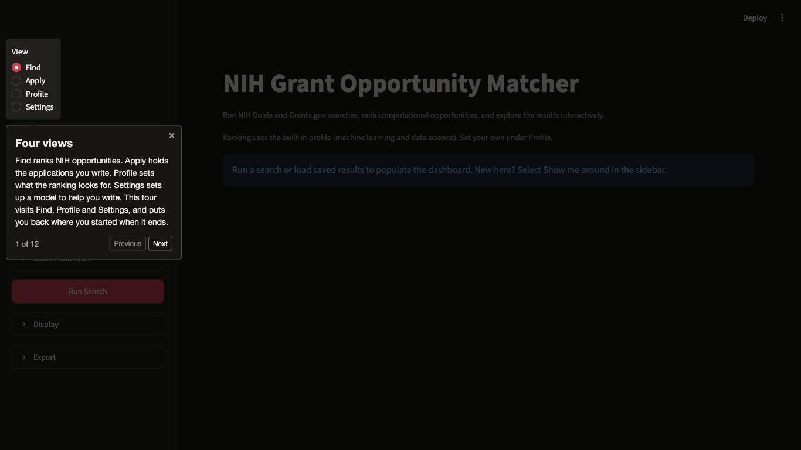

On an empty database the tour had 12 steps. With results loaded it had 15, because three more steps point at the filters, the results, and the Details tab. Started from the Apply view, it ended in the Apply view.

If you are inside a step of the profile wizard, the tour leaves that step. A line under the button says that text you typed in the step since you opened it is lost. Where the step lets you, select **Next** or **Back** first, which keeps it in the draft.

## Set up a model

Skip this section if you write without a model. You can come back to it at any time.

1. Under **View**, select **Settings**.
2. Under **Model**, choose a **Provider**. The four choices are **Claude, from Anthropic**, **OpenAI**, **Gemini, from Google**, and **A server that speaks the OpenAI API, such as Ollama**.
3. Give the provider your key. [Choose a model](dashboard.md#choose-a-model) says where the key is kept and which environment variables supply one.
4. Select **List the provider's models** and choose a **Model**.
5. Read the line that names the host your text goes to. Then select **I agree to send my text to this host**.
6. Select **Test connection**. The test is one short request, and the provider may charge for it.

The example used a server that speaks the OpenAI API, with its address in **Base URL**. The key came from a file that an environment variable names, so the page said `Read from the file that GRANT_MATCHER_LLM_KEY_FILE names.` and nothing was typed into **API key**. The server listed 20 models that write text. The example chose `claude-haiku-5-5`, which is Claude Haiku 5.5. The test answered and reported that it used 152 tokens.

Until you agree to the host, **Test connection** is turned off.

## Run one search before the profile

Step 4 of the profile wizard compares your draft profile with the current one on the opportunities you have saved. With nothing saved, it has nothing to compare. So run one search first.

1. Under **View**, select **Find**.
2. Leave **Keyword** empty and select **Run Search**.

A green message said `Fetched 369 records from nih-guide; saved 369 current NIH/HHS opportunities.` Under the built-in profile for machine learning and data science, the metrics showed 6 **High Matches** and a **Median Score** of 16.1. The first row was a notice from the National Library of Medicine with a score of 100. That ranking serves a data scientist, so Lanternwell needs its own profile.

## Set up your profile

Under **View**, select **Profile**, then **Set up my profile**. The wizard has five steps. Every box has a question mark that says what the box is for, and every text box shows sample text until you type.

The boxes are worded for one investigator. The help says what an organization enters.

### Step 1. You

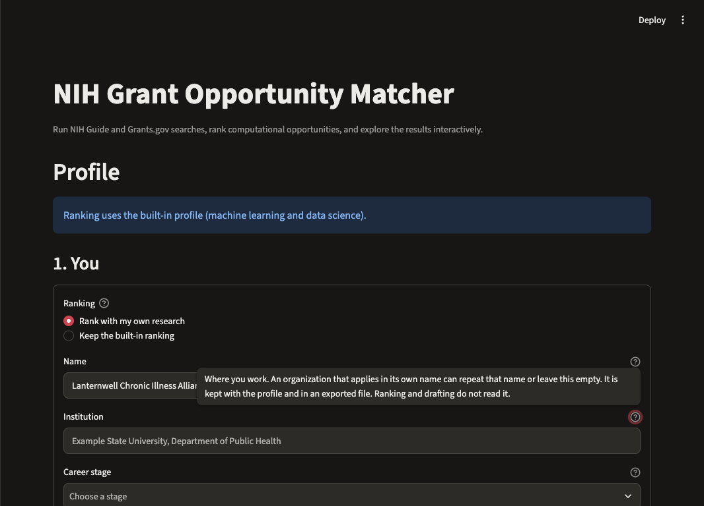

| Box | What the example entered | Why |
| --- | --- | --- |
| **Ranking** | **Rank with my own research** | The other choice keeps the terms for machine learning and data science. |
| **Name** | `Lanternwell Chronic Illness Alliance` | The help says to enter "the name of your organization when the organization is the applicant". |
| **Institution** | Empty | The help says that an organization that applies in its own name can repeat the name or leave the box empty. |
| **Career stage** | Empty | The help says "An organization leaves it empty." |

Select **Next**.

### Step 2. Your research

**Research summary** takes a paragraph on what you study and why it matters. The example entered:

```text
We study how adults who live with chronic illness manage fatigue, chronic pain, and gaps in access to care in rural communities. We work as a community organization with trained peer facilitators, member surveys, and community-based participatory methods, so that self-management support reaches people who live far from specialty clinics.
```

**Aims of recent or planned work** takes three to six sentences. Ranking compares each opportunity with each sentence, so write each one as a study aim and not as a mission statement. The example entered four, one per line:

```text
Aim 1 will test whether a peer-led self-management program delivered by telephone and video reduces fatigue and pain interference in rural adults with chronic illness.
Aim 2 will find the barriers that keep rural adults with multiple chronic conditions from specialty care and from self-management support.
Aim 3 will adapt a symptom self-monitoring diary with patient-reported outcomes for people with energy-limiting chronic illness and pilot test its feasibility and acceptability.
Aim 4 will evaluate whether training peer facilitators as community health workers improves engagement and retention in a behavioral intervention.
```

Select **Next**. With the aims box empty, a red message said `Write three to six sentences. You wrote 0.`

### Step 3. Your terms

The wizard proposes terms from the text of step 2. Do not accept the list as it comes. For the example it proposed 25 single words, each with a weight from 10 to 15:

```text
diary, interference, reaches, telephone, video, surveys, energy, reduces, live, participatory, fatigue, reported, far, find, limiting, clinics, improves, keep, workers, member, symptom, facilitators, we, specialty, adapt
```

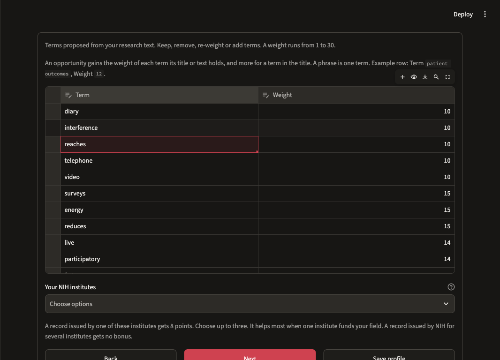

Some of these name the field, such as "fatigue" and "symptom". Many do not, such as "reaches", "live", "far", "find", "keep", and "we". The words that name the field best were missing. The list had no "chronic", "pain", "rural", or "self-management", and it had no phrase at all.

An opportunity gains the weight of each term that its title or text holds. A general word such as "live" would add points to opportunities that have nothing to do with chronic illness. So the example changed the list in three ways:

- It kept five terms: "diary", "participatory", "fatigue", "symptom", and "facilitators". It raised "fatigue" from 13 to 18, because fatigue is central to the work.
- It typed a phrase over each of ten general words. To change a term, select its cell, press Enter, type, and press Enter again.
- It deleted the ten words that were left: "find", "limiting", "clinics", "improves", "keep", "workers", "member", "we", "specialty", and "adapt". To delete a row, select a cell in it, press Shift and Space to select the row, and press Delete.

The table then held 15 terms:

| Term | Weight |
| --- | --- |
| self-management | 20 |
| chronic illness | 18 |
| fatigue | 18 |
| chronic pain | 15 |
| peer support | 15 |
| multiple chronic conditions | 15 |
| community health workers | 14 |
| participatory | 14 |
| patient-reported outcomes | 13 |
| access to care | 13 |
| pain interference | 12 |
| rural | 12 |
| symptom | 11 |
| facilitators | 11 |
| diary | 10 |

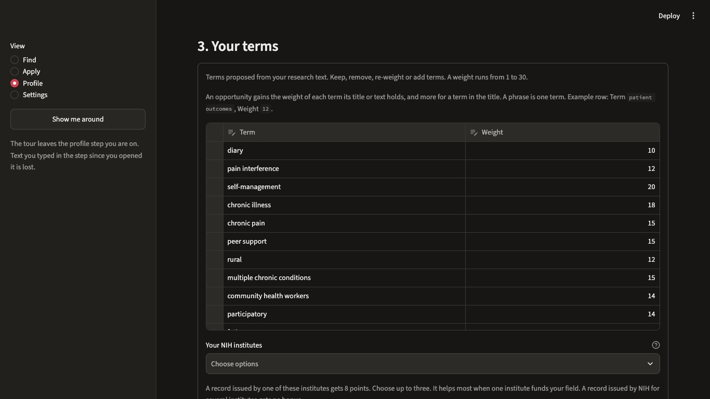

Below the table, **Your NIH institutes** gives 8 points to a record that one of your institutes issued. The example left it empty. The help says "Leave it empty when you are not sure, and no record gets the bonus."

Select **Next**.

### Step 4. Preview

Preview scores the saved opportunities with your draft beside the profile in use. It lists the ten largest rises and the ten largest falls. Nothing is saved yet.

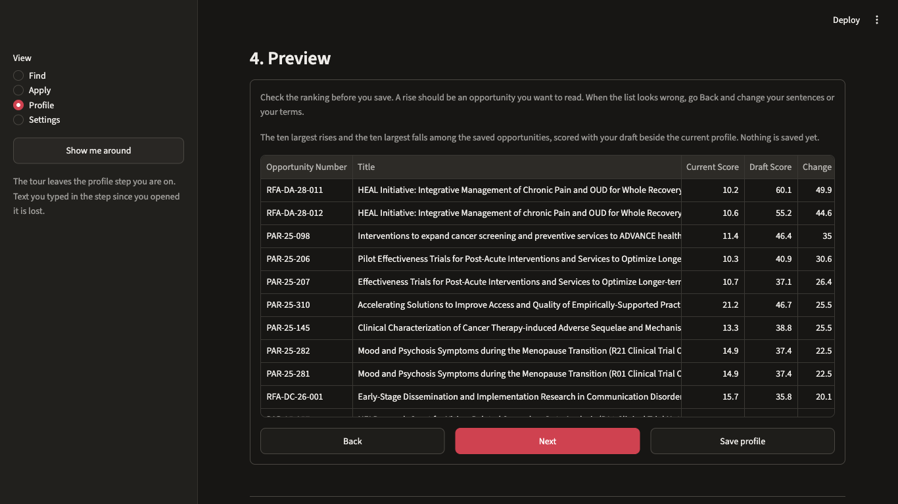

The largest rises in the example:

| Opportunity | Current score | Draft score | Reason given |
| --- | --- | --- | --- |
| RFA-DA-28-011, a HEAL Initiative notice on chronic pain | 10.2 | 60.1 | Matched "chronic pain" |
| RFA-DA-28-012, a second HEAL Initiative notice on chronic pain | 10.6 | 55.2 | Matched "chronic pain" |
| PAR-25-098, interventions to expand cancer screening | 11.4 | 46.4 | Matched "facilitators" |
| PAR-25-206, pilot trials of post-acute interventions | 10.3 | 40.9 | Matched "symptom" |

The largest falls were what the built-in profile ranked first. PAR-26-040, on bioinformatics, fell from 100 to 9. RFA-LM-28-001, on training in biomedical informatics, fell from 100 to 17.9.

Read the list as a test of your terms. The falls were right. The rises were mixed. Chronic pain belongs to the field, but a notice on cancer screening rose only because it holds the word "facilitators". A real applicant would go **Back** and remove or lower a term like that. The example went on, so that this guide shows the ranking those terms produce.

Select **Next**.

### Step 5. What the writer reuses

These three boxes do not change the ranking. The Apply view reuses them.

**Expertise** says what qualifies you or your team. A model reads it when it drafts a section. The example entered:

```text
Ten years of peer support groups for adults who live with chronic illness. Ran 2 member surveys on fatigue, pain, and access to care. The team includes a program director with a public health degree, a part-time research lead with a doctorate in health services research, and 22 trained peer facilitators.
```

**Resources** names the facilities, data, and partners you can use. No model reads it. The example entered:

```text
A member list of 1,400 adults with chronic illness in 14 rural counties. A 2025 member survey with 412 responses. A telephone and video meeting system that the support groups already use. A written agreement with a university partner for human subjects review.
```

The table of prior work takes your own published papers, one per row. Lanternwell has none, so the example left it empty. Do not list another group's paper there. Add it to the application as a reference instead, as [Enter your inputs](#enter-your-inputs) shows.

Select **Save profile**. A green message said `Saved your profile. The Find view now ranks with it.` The line under the page title changed to `Ranking uses the profile of Lanternwell Chronic Illness Alliance, with 15 terms and 4 example sentences.` The button now reads **Edit my profile**.

## Search and read the ranking

Go back to **Find**. The 369 saved opportunities are scored again with the new profile. **High Matches** fell from 6 to 0, and the **Median Score** was 15.4.

### A keyword changes what the search fetches

Enter a **Keyword** and select **Run Search**. The words go to the NIH Guide's own search. The example ran three keywords on 2026-11-24:

| Keyword | Records fetched |
| --- | --- |
| Empty | 369 |
| `self-management` | 366 |
| `chronic pain` | 344 |
| `fatigue` | 4 |

Two of the keywords fetched nearly every open notice, so they narrowed nothing. One word fetched four. A keyword does not change a score. To narrow what you see, use **Filter within results**, as shown below.

After a keyword search, the page shows that search only. To see everything again, open **Display** in the sidebar and select **Load Saved Results**.

### The top of the list is a first look

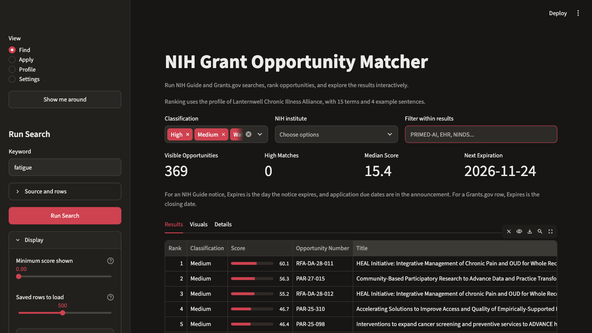

The first five rows of the 369, with each title shortened and the activity code that the title gives:

| Rank | Level | Score | Opportunity | Activity code |
| --- | --- | --- | --- | --- |
| 1 | Medium | 60.1 | RFA-DA-28-011, HEAL Initiative: Integrative Management of Chronic Pain and OUD, Research Centers | RM1 |
| 2 | Medium | 56.3 | PAR-27-015, Community-Based Participatory Research for Optimizing Oral Health for All | UG3/UH3 |
| 3 | Medium | 55.2 | RFA-DA-28-012, HEAL Initiative: Integrative Management of Chronic Pain and OUD, BEACON Center | U2C |
| 4 | Medium | 46.7 | PAR-25-310, Access and Quality of Practices for Youth Mental Health | R01 |
| 5 | Medium | 46.4 | PAR-25-098, Interventions to expand cancer screening | R01 |

The top three are two centers and a phased award. Grant Matcher does not write those codes, and each is far larger than a first project. The score found the right words. It did not judge whether the award fits the applicant.

### Filter to the grants you can write

Type an activity code in **Filter within results**. The filter matches the title, the matched terms, and the summary, and the title of a notice ends with its code.

| Filter | Visible opportunities |
| --- | --- |
| `R21` | 30 |
| `R34` | 11 |
| `R03` | 12 |

The filter also keeps some rows whose title gives another code, such as a K12 row under `R03`. Read the titles.

## Choose an opportunity

Lanternwell has no research grant yet, and its first question is a survey question. An R03 is NIH's small research grant. With the `R03` filter on, the first row was PA-25-302, **NIH Small Research Grant Program (Parent R03 Clinical Trial Not Allowed)**.

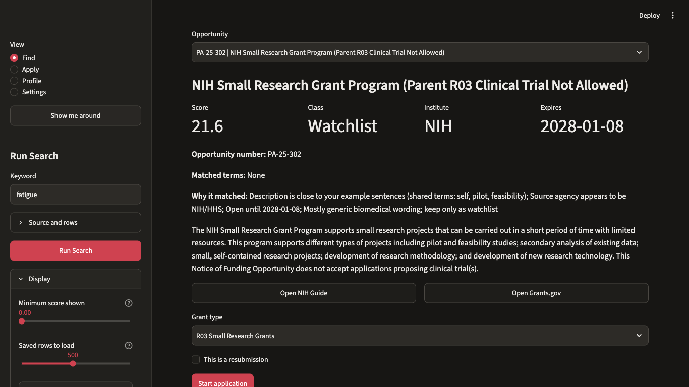

Select the **Details** tab. It showed a score of 21.6, the level Watchlist, the institute NIH, and the date 2028-01-08. **Matched terms** said `None`. The reasons said that the description is close to the example sentences and shares the words "self", "pilot", and "feasibility".

The score is low because a parent announcement names no disease and no topic. It is open to any small project in NIH's mission, so it holds none of the profile's terms. The example chose it for three reasons that the score cannot see:

- Its summary says it supports "pilot and feasibility studies" and "small, self-contained research projects".
- It does not accept clinical trials, and a survey with interviews assigns no intervention.
- By their titles, several of the other R03 rows are limited competitions for people who hold an NIH career award.

That is the lesson of this step. Sort and filter with the score, then read.

## Start the application

1. On the **Details** tab, check **Grant type**. It read `R03 Small Research Grants`.
2. Leave **This is a resubmission** off for a first application.
3. Select **Start application**.

The dashboard opened the **Apply** view on the new application. A line there says that your text, your inputs, and every model call are stored in the database file, and that anyone who can read the file can read them.

The Apply view has five tabs: **Announcement**, **Requirements**, **Your inputs**, **Sections**, and **Log and export**. Work through them from left to right.

## Read the announcement

On the **Announcement** tab, select **Fetch the full announcement**. A green message said `Saved the announcement from the NIH Guide. Confirm or reject what it adds under Requirements.` A line gave the source and the date, `Fetched from the NIH Guide on 2026-11-24.`

Three panels open when selected. Section I is the description of the opportunity. Section IV is the application and submission information. Section V is the review information. Read all three. Section I of PA-25-302 says that the program supports "discrete, well-defined projects that realistically can be completed in two years".

Grant Matcher does not show Section III, the eligibility information. Select **Open the announcement** to read it on NIH's page. On 2026-11-24, Section III of PA-25-302 listed "Nonprofits with 501(c)(3) IRS Status (Other than Institutions of Higher Education)" among the eligible organizations. The same section lists the registrations that an applicant organization must hold, and it says that registration can take six weeks or more. Start those early. Check Section III of your own announcement, because another announcement can list other organizations.

## Decide the requirements

Open the **Requirements** tab.

**Standing rules** come first, with the NIH pages they come from. For an R03 the page listed four:

- Specific Aims. At most 1 page.
- Research Strategy. At most 6 pages.
- Project Summary/Abstract. At most 30 lines.
- Project Narrative. At most 3 sentences.

**What the announcement adds** comes next. Grant Matcher found one requirement in the text on its own, to follow the announcement's additional instructions for the Research Plan.

With a model set up, **Ask the model to read the announcement** sends Sections I, IV, and V to the model, one section in each call. That is three model calls. The example ran it, and a green message said that the model read 32 requirements and that Grant Matcher dropped 3 items of its replies. Grant Matcher drops an item whose quote is not in the announcement.

Each item shows the sentence of the announcement that it comes from, and each item that a model read is marked `A model read this.` A quote proves where a sentence came from. It does not prove that the sentence applies to you. So read each one and select **Confirm** or **Reject**.

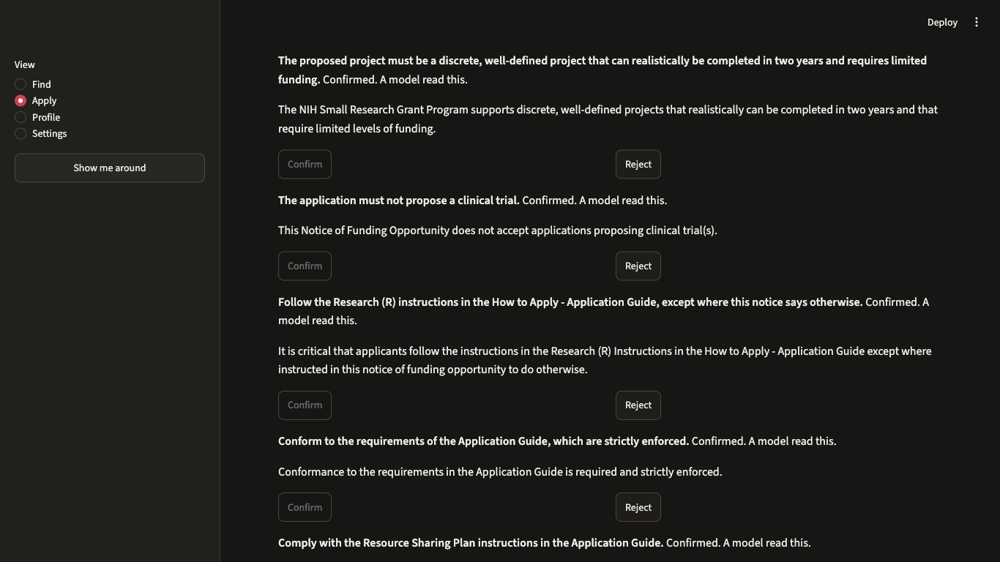

The example confirmed 29 of the 33 items and rejected 4:

- The rule for foreign organizations, because Lanternwell is in the United States.
- The review points for vertebrate animals, for biohazards, and for key biological or chemical resources, because a survey uses none of them.

Many of the confirmed items are about forms and submission, such as the Data Management and Sharing Plan. Grant Matcher does not write those parts. The list still tells you what the whole application needs.

Without a model, read the three panels yourself. The standing rules apply either way.

## Enter your inputs

Open the **Your inputs** tab. An input is one fact about your project, in your words. The sections and the model's drafts are built from them. Lines at the top name what each section still needs. At the start they said that the Specific Aims needed an aim and a hypothesis, and that the Project Narrative needed significance.

For each input, choose a **Kind**, give it a **Key**, type the **Text**, and select **Add input**. The example added ten:

| Kind | Key | Text |
| --- | --- | --- |
| aim | `aim1` | Aim 1. Describe the barriers that keep rural adults with multiple chronic conditions from specialty care and from self-management support, with a mailed and online survey of Lanternwell members in 14 rural counties. |
| aim | `aim2` | Aim 2. Explain how fatigue and pain interference shape those barriers, through interviews with 30 survey respondents and 10 peer facilitators. |
| hypothesis | `h1` | Respondents who report higher fatigue and pain interference will report more missed specialty visits and less use of self-management support, after adjustment for distance to care. |
| preliminary | `survey2025` | In the 2025 Lanternwell member survey, 412 of 1,400 members responded. Of the 412 respondents, 251 said they had missed a specialty visit in the past year because of travel or symptoms. |
| method | `m1` | A cross-sectional survey of adult members with two or more chronic conditions, with validated patient-reported outcome measures of fatigue and pain interference, followed by semi-structured interviews. Peer facilitators help write the questions and recruit. The study assigns no intervention, so it is not a clinical trial. |
| significance | `sig1` | Rural adults with multiple chronic conditions live far from specialty clinics, and fatigue and pain make travel harder. Knowing which barriers matter most tells community organizations and clinics where self-management support should go first. |
| innovation | `inn1` | A community organization of patients leads the study. People who live with chronic illness write the questions, recruit, and interpret the results. |
| team | `team1` | Odalys Brenner, MPH, program director, leads the member survey. Imre Castellan, PhD, part-time research lead, directs the analysis. 22 trained peer facilitators recruit and review the materials. |
| reference | `lauckner2016` | Lauckner HM, Hutchinson SL. Peer support for people with chronic conditions in rural areas: a scoping review. Rural Remote Health. 2016 Jan-Mar;16(1):3601. PMID: 26943760 |
| reference | `angwenyi2018` | Angwenyi V, Aantjes C, Kajumi M, De Man J, et al. Patients experiences of self-management and strategies for dealing with chronic conditions in rural Malawi. PLoS One. 2018;13(7):e0199977. 10.1371/journal.pone.0199977 |

The people and the survey numbers are invented. The two references are real papers by other groups, used as background. Their citations were copied from PubMed's own record on 2026-11-24.

A reference gives its PMID or its DOI in its text. The first one above gives a PMID. The second gives only a DOI.

### Check that each reference exists

Select **Check that each reference exists**. The check sends each PMID to PubMed, or the DOI to Crossref when a reference has no PMID. It sends none of your text, and it uses no model.

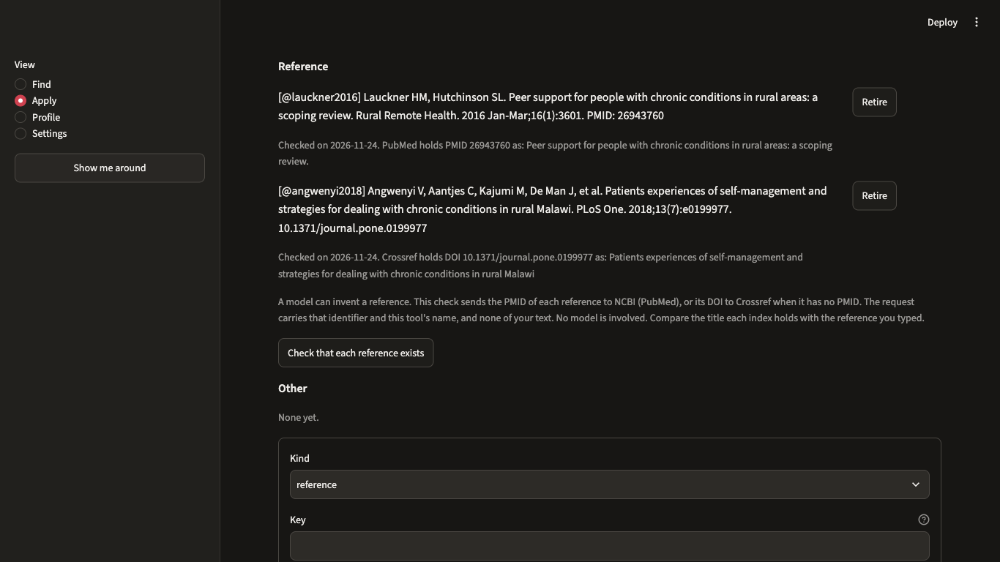

A green message said `Checked 2 references with PubMed or Crossref. The result is under each reference.` Under the first reference, a line said that PubMed holds PMID 26943760 with the same title. Under the second, a line said that Crossref holds the DOI with the same title.

Compare each title with what you typed. The check shows that an identifier exists and what it belongs to. It does not show that the paper says what you claim.

## Write each section

Open the **Sections** tab and choose a **Section**. The example wrote one section by hand and one from a model's draft, to show both.

### Write a section yourself

The example chose **Specific Aims**, typed this text, and selected **Save**:

```text
Rural adults who live with multiple chronic conditions travel far for specialty care, and fatigue and pain make that travel harder. Peer support can help people in rural areas manage chronic conditions [@lauckner2016], and people in rural settings describe their own strategies for self-management [@angwenyi2018]. Community organizations do not know which barriers to address first. In the 2025 Lanternwell member survey, 412 of 1,400 members responded, and 251 of them had missed a specialty visit in the past year because of travel or symptoms.

The long-term goal of the Lanternwell Chronic Illness Alliance is to bring self-management support to rural adults who cannot reach a clinic. The objective of this two-year project is to learn which barriers matter most, and how symptoms shape them. The project assigns no intervention.

Aim 1. Describe the barriers that keep rural adults with multiple chronic conditions from specialty care and from self-management support, with a mailed and online survey of Lanternwell members in 14 rural counties. We hypothesize that respondents who report higher fatigue and pain interference will report more missed specialty visits and less use of self-management support, after adjustment for distance to care.

Aim 2. Explain how fatigue and pain interference shape those barriers, through interviews with 30 survey respondents and 10 peer facilitators.

The results will tell community organizations and clinics where self-management support should go first, and they will shape the design of a later intervention study.
```

A citation is the key of a reference in the form `[@key]`. Two green messages said `Saved revision 1 of the Specific Aims.` and `The checks found nothing to fix in revision 1.` A line under the box said `You wrote 100 percent of the words.`

### See what the checks catch

The checks run on every save. To show them, the example saved a Project Summary/Abstract with two mistakes in it:

```text
We will survey rural adults with multiple chronic conditions about the barriers that keep them from specialty care and from self-management support [@smith2020]. Interviews with 30 respondents and 10 peer facilitators will explain how fatigue and pain interference shape those barriers.
```

Two red messages followed:

- `The citation [@smith2020] names no reference you listed. Add the reference to your inputs or remove the citation.`
- `Project Summary/Abstract is written in the third person. Rewrite each sentence that uses I, we, my or our.`

**Sign off** then answered that the section `cannot be signed off while an error stands.` The example changed "We will survey" to "This project will survey", removed the citation, and saved again. The checks found nothing to fix.

The same checks run on a model's proposal before you take it, as the draft below shows.

### Polish with a model, and decide

**Polish** sends the saved revision to the model and asks it to change the wording only. Its proposal appears below the section, beside your text. Struck words go and bold words come in. Nothing changes until you choose.

The example selected **Polish** on the Specific Aims.

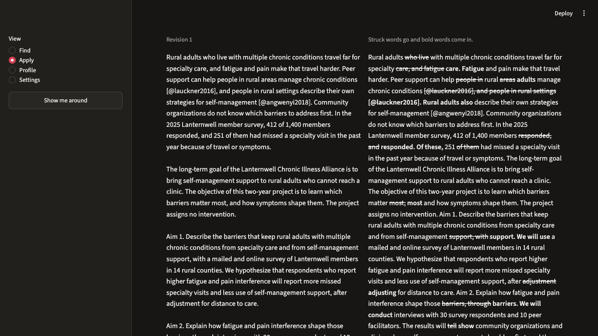

Most of the changes split long sentences. One was not wording. The text said that peer support can help "people in rural areas", and the model wrote "rural adults". The text said that "people in rural settings" describe their strategies, and the model wrote "Rural adults also". Those words narrow what the two papers are said to show.

You have three choices, and [Draft, polish and revise with a model](dashboard.md#draft-polish-and-revise-with-a-model) describes each. The example selected **Discard**. A message said `Discarded the proposal. It stays in the log.` The section stayed at 100 percent your own words.

Read a polish word by word. The checks catch an invented number or citation. They do not catch a change of meaning.

### Ask for a review

**Review against NIH criteria** asks the model to read the saved revision as a reviewer would. It changes nothing. The example ran it on the Specific Aims.

Model output, shortened:

> Importance of the Research, the model's estimate, not NIH's. 3 on NIH's scale from 1, exceptional, to 9, poor.
>
> Rigor and Feasibility, the model's estimate, not NIH's. 4 on NIH's scale from 1, exceptional, to 9, poor.
>
> Weakness (Rigor and Feasibility). The 2025 survey reached 412 of 1,400 members, a response rate near 29 percent, and the section gives no plan for sampling, nonresponse, or the target sample size for the new survey.
>
> Weakness (Rigor and Feasibility). Aim 2 gives sample sizes for interviews but no method for selecting participants, conducting the interviews, or analyzing how fatigue and pain shape the barriers.

Each point quotes the sentence it rests on. The two weaknesses above are fair, and a real applicant would answer them in the Research Strategy. The two scores are one model's guess from one page. The page says so on each line, and so does this guide. The model saw only this section, so it also wrote that the section names no investigators. That is true of an aims page and says nothing about the application.

### Draft a section from your inputs

**Draft from my inputs** writes a section from what you entered. The section needs the inputs that the **Your inputs** tab names for it. [Draft, polish and revise with a model](dashboard.md#draft-polish-and-revise-with-a-model) says what the draft sends, which includes the research summary and the expertise in your profile.

The example chose **Project Narrative**, which takes at most three sentences, and selected **Draft from my inputs**.

Model output:

> Adults with multiple chronic conditions in rural areas live far from specialty clinics, and fatigue and chronic pain make that travel harder. Our two member surveys on fatigue, pain and access to care show [NEEDS INPUT: which barrier the surveys ranked as most important, and the result that supports this]. The answer would tell community organizations and clinics where self-management support should go first.

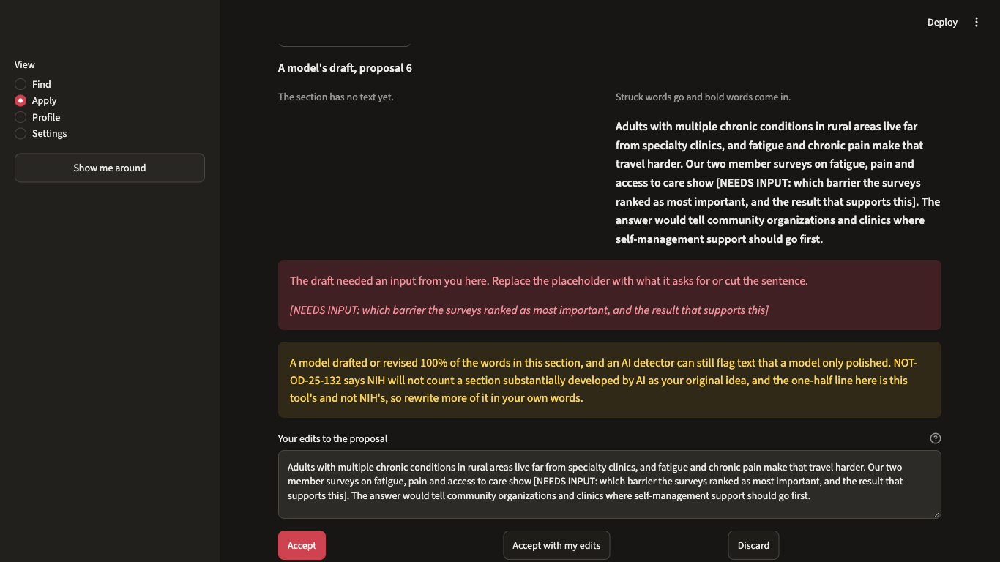

The model had no result to report, so it left a placeholder and did not make one up. A red message named the placeholder and said to replace it or cut the sentence. A yellow message said that a model drafted 100 percent of the words, and that NIH will not count a section substantially developed by AI as your original idea. It names the NIH notice NOT-OD-25-132.

The example then took four steps on this section.

1. It accepted the draft as it came, with the placeholder still in it. The red message stayed, and the share line said `You wrote 0 percent of the words. A model drafted or revised 100 percent`. A new checkbox appeared above **Sign off**. It asks you to confirm that you rewrote what you needed to.
2. It replaced the second sentence in the section box with one of its own, "This project will ask rural adults who live with chronic illness which barriers keep them from specialty care and from self-management support.", and selected **Save**. The red message went. The share line said 36 percent yours and 64 percent the model's, and the yellow message stayed.
3. It typed `Say the first sentence in fewer words.` in **What to change** and selected **Revise**. The model changed "Adults with multiple chronic conditions in rural areas" to "Rural adults with multiple chronic conditions". The example rewrote two more phrases in **Your edits to the proposal** and selected **Accept with my edits**. The share line said 55 percent yours and 45 percent the model's. The yellow message and the checkbox went.
4. It selected **Polish**. The model changed "chronic illness" to "multiple chronic conditions" in the second sentence, which matches Aim 1. The example selected **Accept**.

The final text:

```text
Rural adults with multiple chronic conditions live far from specialty clinics, and fatigue and pain make the trip harder. This project will ask rural adults who live with multiple chronic conditions which barriers keep them from specialty care and from self-management support. Their answers will show community groups and clinics where to put self-management support first.
```

The share line then said `You wrote 52 percent of the words. A model drafted or revised 45 percent, and a model polished 4 percent.` The three shares are rounded, so they can add up to 101.

The Research Strategy was left empty in the example. It is the longest section, and you write it the same way.

## Sign off

A section with no error and with text can be signed off. **Your name** starts with the name in your profile, which is the organization's name here. A sign-off is a person's statement, so the example typed the name of its invented program director, `Odalys Brenner`, and selected **Sign off** on the Specific Aims and on the Project Narrative.

A green message said `Signed off the Specific Aims at revision 1.` The sign-off records that you have read the section, that it states your own ideas, and that you take responsibility for every statement and reference in it.

## Review the log and export

Open the **Log and export** tab.

**Revisions** lists every revision of every section, newest first, with who wrote it. Revision numbers run through the whole application. The example had eight. Revision 2 was `A model's draft`, revision 4 `A model's revision`, revision 6 `A model's polish`, and the rest said `You wrote it`. **Accept with my edits** saved two revisions, the model's text and then yours. Each earlier revision has a **Restore** button.

**AI-use statement** is built from the log, one sentence for each thing the log holds. No model writes it.

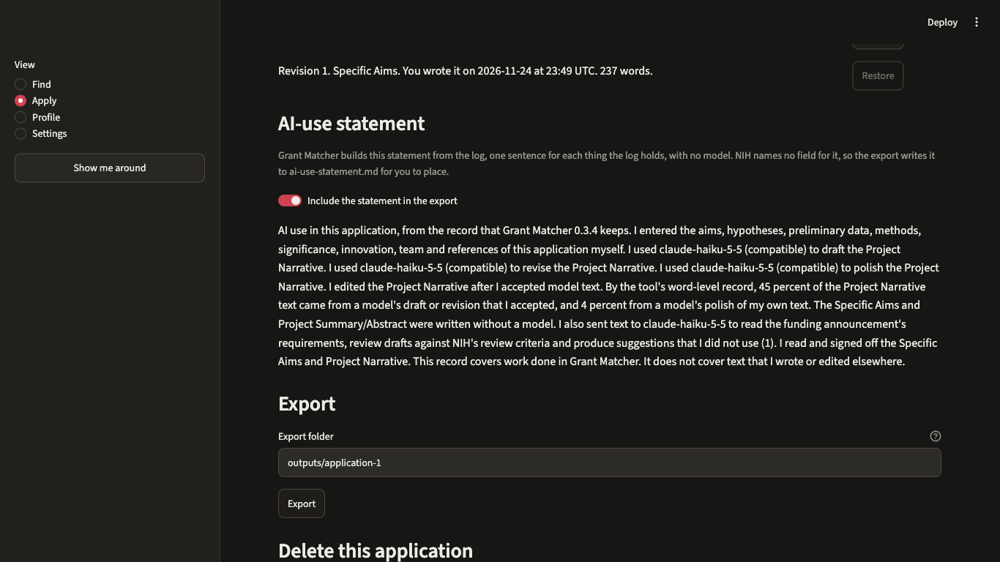

The statement for the example, as the page showed it:

```text
AI use in this application, from the record that Grant Matcher 0.3.4 keeps. I entered the aims, hypotheses, preliminary data, methods, significance, innovation, team and references of this application myself. I used claude-haiku-5-5 (compatible) to draft the Project Narrative. I used claude-haiku-5-5 (compatible) to revise the Project Narrative. I used claude-haiku-5-5 (compatible) to polish the Project Narrative. I edited the Project Narrative after I accepted model text. By the tool's word-level record, 45 percent of the Project Narrative text came from a model's draft or revision that I accepted, and 4 percent from a model's polish of my own text. The Specific Aims and Project Summary/Abstract were written without a model. I also sent text to claude-haiku-5-5 to read the funding announcement's requirements, review drafts against NIH's review criteria and produce suggestions that I did not use (1). I read and signed off the Specific Aims and Project Narrative. This record covers work done in Grant Matcher. It does not cover text that I wrote or edited elsewhere.
```

The statement counts the polish that the example discarded. It says that the Specific Aims were written without a model, because no model text entered that section. NIH names no field for the statement. **Include the statement in the export** writes it to a file for you to place, or leaves it out.

Under **Export**, keep or change **Export folder**, which read `outputs/application-1`, and select **Export**. A green message gave the full path of the folder. It held seven files:

| File | Contents |
| --- | --- |
| `specific-aims.md` | The signed Specific Aims. |
| `project-narrative.md` | The signed Project Narrative. |
| `DRAFT-project-summary.md` | The Project Summary/Abstract. The name starts with `DRAFT-` because the section is not signed off. |
| `DRAFT-research-strategy.md` | A heading and no text, because the section is empty. |
| `requirements.md` | The standing rules with their sources, and each item from the announcement with its sentence and your decision. |
| `provenance-log.md` | The revisions, the announcement with its address and a hash of its text, the inputs with the result of each reference check, the model's review with its scores, and the sign-offs. |
| `ai-use-statement.md` | The statement above. |

The export is Markdown text. Grant Matcher does not fill in the application forms and does not submit. You move the text into your organization's submission system yourself.

## What the model calls cost in this example

The example made nine model calls. Every one is in the log.

| Step | Calls |
| --- | --- |
| **Test connection** | 1 |
| **Ask the model to read the announcement**, one call for each of three sections | 3 |
| **Polish**, once on each of two sections | 2 |
| **Review against NIH criteria** | 1 |
| **Draft from my inputs** | 1 |
| **Revise** | 1 |

The search, the ranking, the reference check, the checks on a section, the AI-use statement, and the export use no model.

## Features this walk-through touched lightly or not at all

- **Export Current View**, under **Export** in the Find sidebar, wrote the 12 rows that the `R03` filter left to an Excel file, and **Download Excel** appeared. See [Export to Excel](dashboard.md#export-to-excel).
- The example did not use the **Visuals** tab, the **Classification** and **NIH institute** filters, **Minimum score shown**, or the `grants.gov` source. See [Narrow the results](dashboard.md#narrow-the-results) and [Run a search](dashboard.md#run-a-search).
- The example did not use **Export profile**, **Import a profile**, or **Reset to built-in**. See [Set your profile](dashboard.md#set-your-profile).
- The example did not retire an input, restore a revision, start a resubmission, or delete an application. See [Write an application](dashboard.md#write-an-application).
- To keep more than one result set, see [Use another database](dashboard.md#use-another-database).

## Do the same steps on the command line

The dashboard's steps have commands. Run them from `NIH Extractor/`. [Use the command line](dashboard.md#use-the-command-line) and [Write an application](dashboard.md#write-an-application) list every command with its options.

| Step in this guide | Command |
| --- | --- |
| Choose a model | `uv run python -m nih_grant_matcher models --provider claude --model NAME --consent` |
| Search | `uv run python -m nih_grant_matcher run --keyword "fatigue"` |
| Show the profile | `uv run python -m nih_grant_matcher profile show` |
| Start the application | `uv run python -m nih_grant_matcher apply start PA-25-302 --type R03` |
| Fetch the announcement | `uv run python -m nih_grant_matcher apply fetch 1` |
| Add an input | `uv run python -m nih_grant_matcher apply add 1 --kind aim --label aim1 --text "Aim 1. ..."` |
| Check the references | `uv run python -m nih_grant_matcher apply verify 1` |
| Save a section | `uv run python -m nih_grant_matcher apply write 1 specific-aims --file aims.txt` |
| Run the checks | `uv run python -m nih_grant_matcher apply check 1` |
| Sign off | `uv run python -m nih_grant_matcher apply sign 1 specific-aims --signer "Odalys Brenner"` |
| Export | `uv run python -m nih_grant_matcher apply export 1 --out export` |

The profile wizard has no command, and you confirm or reject a requirement in the dashboard.

Of these, the walk-through ran `apply list`, `apply check 1`, and `profile show` against the example's database, after the steps above. `apply list` printed one line, `1  PA-25-302  R03  NIH Small Research Grant Program (Parent R03 Clinical Trial Not Allowed)`. `apply check 1` printed each section with its state:

```text
specific-aims  final  237 words
research-strategy  empty  0 words
project-summary  draft  41 words
project-narrative  final  56 words
```

## Use it well

- **The score is a first look.** The three highest scores in the example were awards that Lanternwell could not apply for, and the announcement it chose had a score of 21.6 at the Watchlist level. Sort and filter with the score. Decide by reading.
- **The proposed terms need your hand.** The wizard proposed "we", "live", and "far", and it proposed no phrase. The ranking is only as good as the terms you keep.
- **A keyword may not narrow anything.** Two of three keywords fetched nearly every open notice. Use **Filter within results** to narrow.
- **Eligibility is yours to check.** Grant Matcher shows Sections I, IV, and V. Read Section III on NIH's page, and start the registrations early.
- **A model can invent, and it can shift a claim.** In the example it left a placeholder where it had no fact, which is what it is told to do. It also turned "people in rural areas" into "rural adults" in a polish. The checks catch a made-up citation or number. Only you catch a change of meaning.
- **A model's review is an estimate.** Its scores are not NIH's. Use the points it quotes, and ignore the numbers.
- **The counts are estimates.** [The dashboard guide](dashboard.md#write-an-application) says that a page or line count is an estimate and that the final PDF decides. The share of words that came from a model is the tool's own word-level record, and its one-half line is the tool's and not NIH's.
- **The record covers Grant Matcher only.** Text that you write or edit elsewhere is not in the log or in the AI-use statement.
- **Your text is in one file.** Anyone who can read the database file can read your application. Text that you send to a model goes to the host that the Model section names.
- **Grant Matcher does not submit.** It holds the Specific Aims, the Research Strategy, the Project Summary/Abstract, and the Project Narrative. The forms, the budget, the biosketches, and the plans that the announcement asks for are yours to prepare.
